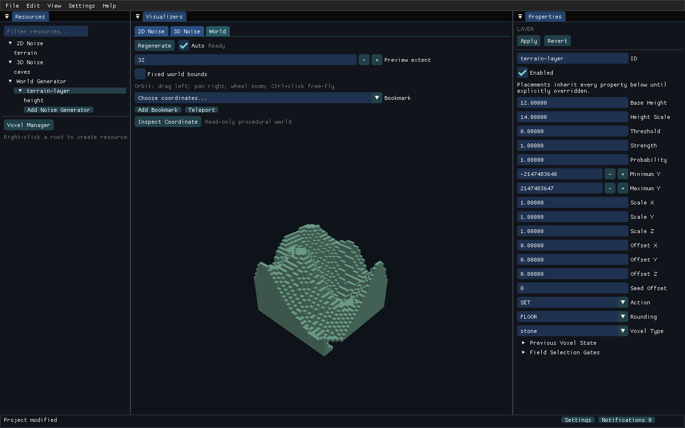

# Procedural Voxel Creator

A native Java 25 procedural-noise and voxel-world editor, with a separately usable headless engine.



This is a **development implementation** of the supplied specification, not a completed A01–A36 release. See [acceptance status](docs/REQUIREMENTS_AND_TESTS.md) for verified behavior and outstanding work.

`main` contains the complete current project. Development-stage branches are temporary and are deleted after integration into main. GitHub testing remains paused until development is complete; the workflow is manual-only. Earlier development-branch references in batch notes describe where those changes were originally authored.

## Build and run

Install Eclipse Temurin **25.0.4+7** (x64). Gradle 9.2.1 is pinned by the wrapper.

```sh
./gradlew clean test build releaseJars
java --enable-native-access=ALL-UNNAMED -jar build/release/jars/ProceduralVoxelCreator.jar
```

On Windows use `gradlew.bat`. The application needs OpenGL 3.0 or newer. CI also exercises software OpenGL. Startup creates an empty, unsaved project with only the protected 2D Noise, 3D Noise and World Generator roots. Right-click a root to create content.

The Windows workflow packages a runtime and native dependencies as a downloadable Actions artifact after its smoke test succeeds. It does not publish a production release automatically.

## Independent headless engine

`build/release/jars/noise-generator-engine.jar` contains the engine and its non-UI dependencies. It includes no ImGui, OpenGL or LWJGL classes.

```sh
./gradlew :example-client:run
```

See [compiled expressions and batches](docs/COMPILED_EXPRESSIONS.md), [placement world-use controls](docs/WORLD_USE.md), [streaming and display LOD](docs/STREAMING_AND_LOD.md), [authoring and stage analysis](docs/AUTHORING_AND_STAGES.md), [typed field processing](docs/FIELD_PROCESSING.md), [API](docs/API.md), [build instructions](docs/BUILD_AND_RUN.md), [decisions](docs/DECISIONS.md), and the [original assignment](docs/SPECIFICATION.md).

Project-owned source has no open-source license grant. Third-party dependency notices are listed in [LICENSES.md](docs/LICENSES.md).

Exact palette storage, immutable bulk edits and v1/v2 archive compatibility are documented in [EXACT_STORAGE.md](docs/EXACT_STORAGE.md).

Structured validation, grouped logs and actionable notifications are documented in [DIAGNOSTICS_AND_RECOVERY.md](docs/DIAGNOSTICS_AND_RECOVERY.md).

Field-driven thresholds, base height and height scale are documented in [NUMERIC_PARAMETER_DRIVERS.md](docs/NUMERIC_PARAMETER_DRIVERS.md).

Queued priorities, cancellation cleanup and cache ownership are documented in [SCHEDULING_AND_CACHE_ADMISSION.md](docs/SCHEDULING_AND_CACHE_ADMISSION.md).

Bounded opt-in timing/metric captures, percentile inspection and explicit JSON/CSV exports are documented in [PROFILING.md](docs/PROFILING.md), including optional [GPU draw timestamps](docs/GPU_DRAW_TIMING.md).

Optional bounded directional mesh shadows are documented in [DIRECTIONAL_SHADOWS.md](docs/DIRECTIONAL_SHADOWS.md).

Development implementations of [volume self-shadowing](docs/VOLUME_SELF_SHADOWING.md), [field-driven transform components](docs/TRANSFORM_PARAMETER_DRIVERS.md), [property control focus](docs/PROPERTY_CONTROL_FOCUS.md), [coarse volume display detail](docs/VOLUME_DISPLAY_DETAIL.md), [attributed work captures](docs/WORLD_WORK_CONTRIBUTIONS.md), [expression error selection](docs/EXPRESSION_ERROR_SELECTION.md), [curve control navigation](docs/CURVE_CONTROL_NAVIGATION.md), [world-setting focus](docs/WORLD_SETTING_CONTROL_FOCUS.md), [owned Project Settings](docs/PROJECT_SETTINGS_TRANSACTIONS.md), [pinned-control browsing](docs/PINNED_CONTROL_BROWSING.md), [semantic input sharing](docs/SEMANTIC_INPUT_SHARING.md) and [provisional seed inputs](docs/PROVISIONAL_SEED_INPUTS.md) are awaiting validation. GitHub testing is deferred until the program is fully developed; ongoing work is saved on the development branch.

Fragmentation recovery and explicit GPU maintenance are documented in [GPU_ARENA_COMPACTION.md](docs/GPU_ARENA_COMPACTION.md).

Context-aware remapping, transactional binding drafts and atomic preference persistence are documented in [KEYBOARD_INPUT.md](docs/KEYBOARD_INPUT.md).

Future-item defaults and transactional presentation/help settings are documented in [APPLICATION_PROFILES.md](docs/APPLICATION_PROFILES.md).

Theme preview, persistence and contrast feedback: [THEMES_AND_CONTRAST.md](docs/THEMES_AND_CONTRAST.md).

Large resource browsing, filtering and selection: [RESOURCE_BROWSING.md](docs/RESOURCE_BROWSING.md).

Resource pickers, membership editing and export previews: [RESOURCE_SELECTION_WORKFLOWS.md](docs/RESOURCE_SELECTION_WORKFLOWS.md).

Unified Find, precise references and protected navigation: [UNIFIED_FIND.md](docs/UNIFIED_FIND.md).

Mixed resource ordering and World folders: [RESOURCE_HIERARCHY.md](docs/RESOURCE_HIERARCHY.md).

Stable portable import previews and guarded publication: [IMPORT_TRANSACTIONS.md](docs/IMPORT_TRANSACTIONS.md).

Searchable coordinate bookmarks and tab-owned navigation dialogs: [BOOKMARKS_AND_NAVIGATION.md](docs/BOOKMARKS_AND_NAVIGATION.md).

Typed noise authoring, bounded controls and explicit dependency resolution: [NOISE_AUTHORING_WORKFLOWS.md](docs/NOISE_AUTHORING_WORKFLOWS.md).

The sampled-calculus and distance-shape extension adds twelve dimension-aware operations, canonical control metadata and creation defaults. See [field operation semantics](docs/FIELD_CALCULUS_AND_DISTANCE.md). Validation passed after implementation: 502 tests, native workflows, independent mathematical consumers and cross-platform packaging. Full GUI/hardware acceptance remains separate.

The trace-explanation extension adds bounded canonical noise observations, actual comparison/provenance records, one clipped Inspector/Logs view, bounded retained payloads and guarded UUID/control navigation. See [trace contracts](docs/TRACE_EXPLANATIONS_AND_NAVIGATION.md). Validation passed after implementation: 544 tests, native workflows, independent engine-only replay and cross-platform packaging. Full GUI/hardware certification remains separate.

The source-algorithm contract batch centralizes dimensional parameter signatures, named enum authoring, precise validation and creation metadata, with independent upstream C++/Python vectors and JVM raw-bit comparisons. See [source algorithm contracts](docs/SOURCE_ALGORITHM_CONTRACTS.md). Validation passed after implementation: 570 tests, native workflows, independent C++/Python vectors, matching pinned-JVM bit digests and cross-platform packaging. Hardware and full GUI certification remain separate.

The scalar-remapping batch adds weighted noise combinations, explicit falloff domains/metrics/shapes, signed terraces, descending remap clamping and canonical transfer previews. Validation passed after implementation: 599 tests, 548 independent vectors, native Apply/Undo workflows and cross-platform packaging. See [scalar controls](docs/SCALAR_REMAPPING_AND_BLENDING.md) and [evidence](docs/evidence/SCALAR_REMAPPING_VALIDATION.md). Full warp controls and GUI/hardware certification remain separate.

The shared-warp batch adds canonical algorithm/source controls, sampled displacement fields and independent/progressive/sequential octaves to both coordinate and processing stages. Validation passed after implementation: 633 tests, 432 independent vectors across 864 stage cases, native editing and cross-platform packaging. See [warp contracts](docs/WARP_FIELDS_AND_MODES.md) and [evidence](docs/evidence/WARP_CONTROLS_VALIDATION.md). Complete GUI/hardware acceptance remains separate.

Phased placement drivers now control sampling scale/offset and strength/probability with fixed baseline queries, explicit source validation and trace coordinates. Post-implementation validation passed 655 tests, native editing, independent replay and platform packaging. See [driver contracts](docs/NUMERIC_PARAMETER_DRIVERS.md) and [evidence](docs/evidence/PLACEMENT_DRIVER_PHASE_VALIDATION.md). Full GUI/hardware acceptance remains separate.

Browser row and Voxel Manager selection now use an owned Apply/Discard/Cancel guard for modified Properties drafts. Same-owner clicks preserve provisional text; Ctrl/Shift plans and stale decisions preserve sibling and draft ownership. This development implementation and deferred verification definitions are **uncompiled and untested**; see [resource selection guards](docs/RESOURCE_SELECTION_GUARDS.md).

Resource browser mutations now guard unapplied Properties input and publish explicit Apply plus the requested action as one undoable transaction. Failed actions retain the draft; successful edits reconcile selection and cut payload ownership. This implementation and its deferred definitions are **uncompiled and untested**; see [browser transactions](docs/RESOURCE_BROWSER_TRANSACTIONS.md).

New/Open/Exit now protect unapplied Properties input before the committed-document save decision, including raw seed text on a clean project. Canceled/failed transitions retain drafts, and stale file decisions abort before I/O. Standalone Save remains committed-only. This implementation and deferred definitions are **uncompiled and untested**; see [draft transition ownership](docs/PROJECT_DRAFT_TRANSITIONS.md).

Project Undo/Redo now protects unapplied Properties input with an explicit discard-or-cancel decision. History candidates validate before either stack moves; successful steps reconcile selection and retain explicit-save dirty tracking. Implementation and deferred definitions are **uncompiled and untested**; see [history ownership](docs/PROJECT_HISTORY_OWNERSHIP.md).

Import now uses an owned COPY/REUSE/SKIP workspace with explicit stale-preview reload, filtered/clipped rows, bounded diagnostics and displayed-plan Apply gating. It preserves separate Properties drafts. Implementation and deferred definitions are **uncompiled and untested**; see [import workspace](docs/IMPORT_WORKSPACE.md).

The unvalidated development branch adds [manual update results and verified release links](docs/MANUAL_UPDATE_CHECKS.md), alongside [private update trust and safe configuration persistence](docs/UPDATE_TRUST_AND_PREFERENCE_FILES.md). Checks require an explicitly applied endpoint; normal startup performs no update request.

The unvalidated [workspace lifecycle follow-up](docs/WORKSPACE_LIFECYCLE.md) adds durable docking resets, visible side-panel docking actions, saved tool visibility and normal main-window size capture. Physical monitor/DPI and full workspace acceptance remain pending.

The unvalidated [performance preference editor](docs/PERFORMANCE_PREFERENCES.md) stages coupled preview limits and exact 64-bit cell budgets together, with explicit Apply/Revert, failed-save recovery and restart notices. GitHub validation remains paused.

The unvalidated [main-window placement follow-up](docs/MAIN_WINDOW_PLACEMENT.md) saves normal position/maximized intent, fits startup bounds to current monitor work areas, adds Center Main Window and guards startup/recursive native resize frames. Physical monitor/DPI and window-manager acceptance remain pending.

The unvalidated [UI scale follow-up](docs/UI_SCALING.md) extends per-window font multipliers to nineteen top-level targets and adds searchable private scale editing with explicit Apply/Revert and failed-save recovery. Full production-window, popup and physical DPI acceptance remain pending.

The unvalidated [modal layout follow-up](docs/DIALOG_LAYOUT.md) fits sixteen modal presentations to their hosting viewport work areas, wraps action rows and replaces several fixed-width panels. Physical detached-host/monitor and DPI acceptance remain pending.

The unvalidated [selector layout follow-up](docs/SELECTOR_LAYOUT.md) anchors resource/bookmark popups inside their hosting viewport, fits searchable lists to available space and wraps bookmark toolbar actions. Physical monitor/DPI acceptance remains pending.

The unvalidated [Curve Editor layout follow-up](docs/CURVE_LAYOUT.md) keeps Apply/Cancel outside the scrolling inspector, fits floating bounds with docking/monitor-coordinate ownership, and separates plot zoom from body scrolling. Physical monitor/DPI acceptance remains pending.

The unvalidated [status and utility layout batch](docs/STATUS_AND_UTILITY_LAYOUT.md) reserves a measured bottom status strip, keeps notifications reachable in narrow layouts, preserves dock identity and extends floating bounds to thirteen utility/settings windows. GitHub testing remains paused.

The unvalidated [core window layout batch](docs/CORE_WINDOW_LAYOUT.md) extends outer bounds to the five remaining scale targets and adds responsive Inspector XYZ columns with stable raw input, plus bounded browser/trace actions. Full internal-layout and physical DPI acceptance remain pending.

The unvalidated [popup monitor work-area follow-up](docs/POPUP_MONITOR_WORK_AREAS.md) intersects covered modals/selectors with current monitor work areas in absolute-coordinate mode and recovers offscreen detached owners to a usable main client. Relative/no-inventory and physical acceptance limits remain explicit.

The unvalidated [DPI/font-density batch](docs/UI_DPI_AND_FONT_DENSITY.md) combines display density with user/window multipliers before each frame, adds a denser default atlas and preserves nested child/popup font sizes. Physical DPI, GPU font upload and visual quality remain unverified.

The unvalidated [local choice/navigation popup batch](docs/DRAFT_POPUP_LAYOUT.md) bounds local typed-choice selectors, keeps draft-guard actions in a persistent row and preserves the freshness owner of pending source links. Its regression/native/replay definitions remain unexecuted.

The unvalidated [Application Settings layout batch](docs/APPLICATION_SETTINGS_LAYOUT.md) keeps four profile actions outside scrolling content, reflows list/detail panes and stacks numeric controls while preserving private input and field identity. Deferred checks remain unexecuted.

The unvalidated [Appearance layout batch](docs/APPEARANCE_SETTINGS_LAYOUT.md) keeps scale actions persistent, stacks numeric rows, reveals hidden invalid fields and places active preference/theme controls inside the scrolling body. Deferred checks remain unexecuted.

The unvalidated [Input Settings layout batch](docs/INPUT_SETTINGS_LAYOUT.md) reflows clipped shortcut rows, keeps edit/recording actions persistent and preserves same-frame capture suppression during cancellation and retry. Deferred checks remain unexecuted.

The unvalidated [Themes layout batch](docs/THEME_LAYOUT.md) adds persistent recovery actions, responsive palette/contrast panes and RGBA rows, plus sticky rejected-channel save guards. Deferred checks remain unexecuted.

The unvalidated [preference forms layout batch](docs/PREFERENCE_FORMS_LAYOUT.md) gives performance limits, update trust and Workspace separate scrolling bodies and persistent actions, preserving independent private drafts and exact save/retry behavior. Deferred checks remain unexecuted.

The unvalidated [general settings layout batch](docs/GENERAL_SETTINGS_LAYOUT.md) keeps Project Settings transactions and live Editor/Visualization actions reachable, with supported shadow choices and shared Debug/Profiler capture controls. Deferred checks remain unexecuted.

The unvalidated [Profiler workspace batch](docs/PROFILER_LAYOUT.md) adds retained sections, exact next-capture limits, persistent capture/export actions and logical series IDs across filtering/reflow. Deferred checks remain unexecuted.

The unvalidated [diagnostic workspace batch](docs/DIAGNOSTICS_LAYOUT.md) adds responsive result/detail panes and persistent recovery actions, cached immutable event views, displayed-occurrence acknowledgements and publication-owned validation selection. Deferred checks remain unexecuted.

The unvalidated [Find/Trace workspace batch](docs/FIND_AND_TRACE_LAYOUT.md) separates Find filters/results, keeps navigation/copy/paging actions persistent and binds source decisions to exact committed hits or trace observations. Deferred checks remain unexecuted.

The unvalidated [ready editor startup batch](docs/READY_EDITOR_STARTUP.md) keeps native initialization hidden through a rendered editor frame, delays detached presentation, and adds shared failure cleanup and preference guards. Nineteen regression definitions and eight real Desktop scenarios remain unexecuted; physical startup/DPI acceptance remains pending.

The unvalidated [Help/context/About batch](docs/HELP_AND_ABOUT.md) adds active-metadata options and related-topic search, retained topic navigation, explicit Inspector/menu context links and scrollable runtime/license sections with complete copying. Eleven regression definitions and 24 native layout cases remain unexecuted.

The unvalidated [tooltip/fractional-font batch](docs/TOOLTIPS_AND_FRACTIONAL_FONTS.md) preserves fractional inherited text height, adds bounded scaled hover previews and routes outer color/resource drag previews through that scale path. Eleven regression definitions and 30 native cases remain unexecuted.

The unvalidated [expanded expression layout batch](docs/EXPANDED_EXPRESSION_LAYOUT.md) keeps staging/cancellation/error actions persistent, measures editor/feedback viewports and preserves exact error selection through clipping and correction. Eleven regression definitions and six native size scenarios with recovery phases remain unexecuted.

The unvalidated [Inspector layout batch](docs/INSPECTOR_LAYOUT.md) separates Coordinates/Trace, keeps request/restoration/bookmark actions persistent, focuses invalid displayed XYZ and invalidates source decisions after hidden trace replacement. Seven added regression definitions and twelve native layout cases with recovery phases remain unexecuted.

The unvalidated [resource review layout batch](docs/RESOURCE_REVIEW_LAYOUT.md) adds persistent Import/Membership actions, separate review/filter/issue pages, measured clipped rows and Cancel-before-Apply decisions. Nine regression definitions and thirty native page/size cases with transaction recovery remain unexecuted.

The unvalidated [package path/export layout batch](docs/PACKAGE_LAYOUT.md) adds persistent file actions, Choices/Included/Path pages, explicit dependency-preview review and same-frame Cancel priority before I/O. Nine regression definitions, twenty-four native page/size cases and existing engine-only package replay remain unexecuted.

The unvalidated [export hierarchy batch](docs/EXPORT_HIERARCHY.md) adds authored-order folder/layer disclosures, ancestor-aware search, explicit-versus-included choice markers and read-only included hierarchy. Ten regression definitions, twelve native layout cases and operation-only carrier/dependency engine replay remain unexecuted.

The unvalidated [project decision layout batch](docs/PROJECT_DECISION_LAYOUT.md) adds persistent file/history actions, Cancel-before-mutation handling, request-scoped native IDs and retained path/focus recovery. Five regression definitions, thirty-six native form/size cases and independent saved/opened engine replay remain unexecuted.

The unvalidated [resource draft decision layout](docs/RESOURCE_DECISION_LAYOUT.md) keeps selection, browser-action, Source and Find decisions reachable through scrolling explanations and persistent actions. Escape wins simultaneous clicks; post-commit UI refresh callbacks are consumed once. Four regression definitions, eighteen native layout cases and independent replay remain deferred.

The unvalidated [resource form layout follow-up](docs/RESOURCE_FORMS_LAYOUT.md) adds persistent actions to Create, Add Noise Generator, Delete and noise resolution, with searchable replacement and scrolling diagnostics. Browser forms reject stale committed owners; Cancel/Escape takes precedence over submission. Five regression definitions, thirty native cases and independent replay remain deferred.

The unvalidated [private editor decision follow-up](docs/PRIVATE_EDITOR_DECISIONS.md) scopes Expression/Membership/Curve actions to each opening, keeps Curve Apply/Cancel on explicit persistent rows and blocks same-frame Escape publication. Membership also rejects sessions from a reopened project. Three regression definitions, eighteen native reflow cases and independent replay remain deferred.

The unvalidated [Properties layout follow-up](docs/PROPERTIES_LAYOUT.md) keeps Apply/Revert/Show Problems outside scrolling fields, protects footer actions across draft/context changes and disables parent mutation while a private editor is open. Six regression definitions, forty-eight native layout cases and independent replay remain deferred.

The unvalidated [settings decision follow-up](docs/SETTINGS_DECISIONS.md) gives Project Cancel/focused Escape priority and scopes project/profile actions across cancellation, reload and draft resets. Application Escape suppresses mutation while failed saves retain raw input for explicit retry. Four regression definitions, twelve native layout cases and independent replay remain deferred.

The unvalidated [preference decision follow-up](docs/PREFERENCE_DECISIONS.md) scopes Performance, Update trust and UI scale actions to their owned active values and private resets. Escape suppresses footer mutation; failed saves preserve raw retry state, and unrelated preference forms remain independent. Four regression definitions, eighteen native cases and independent replay remain deferred.

The unvalidated [Theme/Input decision follow-up](docs/INTERACTIVE_PREFERENCE_DECISIONS.md) scopes footer activation to private resets, owned active values and preview/recording transitions. Escape suppresses publication, cancellation retains recording suppression and failed saves preserve retry ownership. Five regression definitions, twelve native cases and independent replay remain deferred.

The unvalidated [bookmark layout follow-up](docs/BOOKMARK_LAYOUT.md) keeps Apply/Cancel and field/feedback navigation outside scrolling content. Cancel/Escape precedes publication, scoped IDs protect each opening, and callback cleanup preserves newly admitted dialogs. Sixty native layout definitions and independent project/Undo replay remain deferred.

The unvalidated [manual update layout follow-up](docs/UPDATE_CHECK_LAYOUT.md) keeps check/configure/link actions outside scrolling results and scopes them to exact requests, phases and reviews. Escape cancels running checks or suppresses other actions; failed links retain retry context and callback feedback cannot leak into successor requests. One regression definition, forty-two native layout cases and independent replay remain deferred.

The unvalidated [Profiler/Debug decision follow-up](docs/PROFILER_DECISIONS.md) separates live capture, displayed snapshot and frozen export-review action scopes. Escape suppresses footer mutation, held predecessors cannot retarget replacements, and capture changes retain independent export retry IDs. Two regression definitions, sixty-six native layout cases and independent capture/project replay remain deferred.

The unvalidated [immediate-settings decision follow-up](docs/IMMEDIATE_SETTINGS_DECISIONS.md) scopes Workspace/Editor/Visualization callbacks, suppresses Escape actions and releases held presentations when hidden. Workspace Save Preferences joins its persistent footer; immediate edits and active-only save retries retain their semantics. Twenty-four native layout definitions and independent preference/project replay remain deferred.

The unvalidated [private-preference ordinary-save follow-up](docs/PRIVATE_PREFERENCE_SAVES.md) defers Save/Open Themes callbacks until complete private-form drawing and arbitration. Hidden categories/Performance sections release action contexts while retaining drafts; Input save preserves recording suppression. Twenty-four native layout definitions and independent active-only preference/project replay remain deferred.

The unvalidated [diagnostic footer decision follow-up](docs/DIAGNOSTIC_DECISIONS.md) scopes selected-entry actions separately from reviewed bulk history and exact validation selections. Escape suppresses footer actions, hidden presentations retire held gestures, and callback failures become retained actionable logs. One regression definition, eighteen native layout cases and independent project/history replay remain deferred.

The unvalidated [Find/Trace footer decision follow-up](docs/UTILITY_DECISIONS.md) binds actions to raw query, selection, page and document context, suppresses Escape and contains Trace callback failures. Separate native-host lifetimes retire hidden gestures while shared trace views retain stable IDs. Four regression definitions, eighteen native reflow cases and independent project/clipboard replay remain deferred.

The unvalidated [Help/About/context decision follow-up](docs/MANUAL_DECISIONS.md) scopes footers to exact displayed manual/history or runtime-section reviews, suppresses Escape and contains clipboard/Help callback failures. Context requests retire on source changes, missing submissions, reopening and instance replacement. Two regression definitions, thirty native reflow cases and independent complete-copy/project replay remain deferred.

The unvalidated [Inspector decision follow-up](docs/INSPECTOR_DECISIONS.md) scopes footers to exact request/snapshot, raw/displayed XYZ, page and document context. Escape and hidden presentations suppress held actions; late task attachment/completion also requires the exact admitted request. Six regression definitions, twelve native reflow cases and independent coordinate/project replay remain deferred.

The unvalidated [selector decision follow-up](docs/SELECTOR_DECISIONS.md) consumes exact UUID/key/None choices after complete popup drawing and native cleanup. Owner changes retire requests, source/query changes version rows, and failures offer an owned explicit retry without overwriting successor openings. Five regression definitions, twenty-four native reflow cases and independent callback/project replay remain deferred.

The unvalidated [bookmark toolbar/picker follow-up](docs/BOOKMARK_DECISIONS.md) scopes commands to exact tab, selection, document and dialog reviews, moves navigation after native cleanup, and rechecks coordinate capture before editing or opening a dialog. Four regression definitions, thirty-six native reflow cases and independent Update/Delete Undo/Redo replay remain deferred.

The unvalidated [World stage boundary selection follow-up](docs/STAGE_BOUNDARY_SELECTION.md) adds searchable clipped layer/operation UUID choices, cached immutable pipeline labels and explicit missing/empty boundary recovery. Four regression definitions, eighteen native reflow cases and an independent engine-only stage replay remain deferred.

The unvalidated [visualizer command follow-up](docs/VIEWPORT_COMMANDS.md) collects source-owned Regenerate/Auto and bounded context-menu decisions, runs callbacks after native cleanup and preserves explicit successors. Auto publishes its live preference only after a successful atomic save. Four regression definitions, thirty-six native reflow cases and independent project/preference/engine replay remain deferred.

The unvalidated [preview Resume follow-up](docs/PREVIEW_RESUME_DECISIONS.md) ties recovery to an exact pause episode, accepted source and current limits, rechecks after clock callbacks and consumes admission before refresh. Five regression definitions, eighteen native reflow cases and independent pressure-policy/project/engine replay remain deferred.

The unvalidated [finite visualizer options follow-up](docs/VIEWPORT_OPTIONS.md) adds bounded source-owned Display/Representation/Slice normal/Stage preview popups and a guarded Inspect Coordinate opener. Complete native cleanup precedes choices and failures retain explicit owned retries. Two regression definitions, thirty native reflow cases and independent field/stage/project replay remain deferred.

The unvalidated [visualizer control-pane follow-up](docs/VIEWPORT_CONTROL_PANES.md) reserves preview space beneath a stable scrolling control body, bounds numeric fields and sample/histogram regions, rejects non-finite view doubles and reveals new Resume controls. Three regression definitions, twenty-four native reflow cases and shared independent field/world replay remain deferred.

The unvalidated [noise numeric-control follow-up](docs/NOISE_NUMERIC_CONTROLS.md) pairs source, processing, transform, warp, literal and shared-parameter inputs with responsive sliders while retaining exact text focus and private Apply. Two regression definitions, 84 native layout receipts and independent complete-project/scalar/EMPTY-world replay remain deferred.

The unvalidated [World numeric-control follow-up](docs/WORLD_NUMERIC_CONTROLS.md) extends paired controls to defaults, explicit overrides, drivers, gates, intervals and sampling transforms. Exact integer input, sparse inheritance and non-finite draft repair are preserved; eighteen native layout cases and independent complete-project/voxel/trace replay remain deferred.

The unvalidated [Curve numeric-control follow-up](docs/CURVE_NUMERIC_CONTROLS.md) pairs curve fields with sliders, preserves exact text focus and coalesces each owned slider drag into one local Undo step. Seven regression definitions, extended layout receipts and native/independent parent-publication replay remain deferred.

The unvalidated [application profile numeric follow-up](docs/PROFILE_NUMERIC_CONTROLS.md) removes creation-slider display rounding and pairs presentation order with exact input. Raw validation, private profile publication and existing project state stay intact; native and independent persisted-default/engine replay definitions remain deferred.

The unvalidated [preview document-lifetime follow-up](docs/PREVIEW_DOCUMENT_LIFETIME.md) retires accepted visuals, caches and pending Inspector work on Open/New, including same-UUID reopening without a revision change. Same-document manual preview retention remains. Six regression definitions, a production GL/worker workflow and independent project/engine replay remain deferred.

The unvalidated [World palette source-order follow-up](docs/WORLD_PREVIEW_PALETTES.md) binds retained fixed/streamed geometry and removal ghosts to their source UUID order, refreshes current colors without regenerating geometry and applies late color edits at acceptance. Six regression definitions, eleven native pixel/palette phases and independent field/stage/world replay remain deferred.

The unvalidated [retained trace document-lifetime follow-up](docs/TRACE_DOCUMENT_LIFETIME.md) binds production snapshots to their originating document, distinguishes same-UUID reopening from current traces and disables historical source links until a new trace is requested. Six regression definitions, twenty-four native Inspector/Logs presentation receipts and independent exact trace replay remain deferred.

The unvalidated [Logs-to-Inspector follow-up](docs/TRACE_INSPECTOR_HANDOFF.md) adds a bounded Trace In Inspector action for retained same-project traces, preserves separately entered XYZ and evaluates the displayed historical coordinate in the current document. Six regression definitions, twelve native footer receipts and extended real-worker document replay remain deferred.

The unvalidated [exact Inspector retry follow-up](docs/INSPECTOR_TRACE_RETRY.md) retains the last failed coordinate and offers Retry Trace without replacing entered XYZ or borrowing an older result. Six regression definitions, twelve native Inspector receipts and real full-queue recovery definitions remain deferred.

The unvalidated [trace source availability follow-up](docs/TRACE_SOURCE_AVAILABILITY.md) disables changed/missing/private-unavailable source links with specific explanations, caches bounded committed-definition checks and keeps private control availability live. Six regression definitions, twelve native footer receipts and independent trace replay remain deferred.

The unvalidated [guarded source completion follow-up](docs/GUARDED_SOURCE_COMPLETION.md) rechecks source links after Apply, preserves committed edits when a trace source changed, contains source/reveal failures and protects successor drafts. Nine regression definitions, twelve native modal receipts and independent project/trace replay remain deferred.

The unvalidated [shared draft decision delivery follow-up](docs/NAVIGATION_DECISION_DELIVERY.md) delivers Apply/Discard/Cancel after popup unwind, protects successor dialogs and limits rendering/delivery to once per frame. Six regression definitions, twelve native modal receipts, ten delivery routes and extended production source callbacks remain deferred.

The unvalidated [Find/reference private-editor eligibility follow-up](docs/NAVIGATION_PRIVATE_EDITOR_ELIGIBILITY.md) rechecks pending Apply/Discard decisions against live private property editors while preserving drafts and raw input. Nine regression definitions, twelve native modal receipts, nine integration routes and independent project/engine replay remain deferred.

The unvalidated [named dialog scaling follow-up](docs/DIALOG_OWNER_SCALING.md) keeps modal body/control text tied to its configured owner when another window draws it, including hidden owners and DPI composition. Eight regression definitions, thirty native font/geometry cases and independent persistence/trace replay remain deferred.

The unvalidated [project history completion follow-up](docs/PROJECT_HISTORY_COMPLETION.md) delivers Undo/Redo confirmations after popup unwind, preserves successor requests and keeps accepted moves busy through validation/refresh. Eight regression definitions, twelve native modal receipts, ten completion routes and independent persistence/engine replay remain deferred.

The unvalidated [project file completion follow-up](docs/PROJECT_FILE_COMPLETION.md) separates successful publication from callback failures, preserves successor file actions and delivers decisions/I/O after popup unwind. Ten regression definitions, twenty-four native modal receipts, eleven routes and independent persistence/engine replay remain deferred.

The unvalidated [resource review lifetime follow-up](docs/RESOURCE_REVIEW_LIFETIME.md) retires Import/Export reviews after reopening a document, protects active publication from nested actions/cleanup and rechecks the latest project path before package replacement. Eleven regression definitions, twenty-four native receipts and independent persistence/engine replay remain deferred.

The unvalidated [resource dialog delivery follow-up](docs/RESOURCE_DIALOG_DELIVERY.md) delivers Import/package actions after popup closure, protects successor reviews from old gestures and contains callback failures. Ten regression definitions and seven additional native delivery routes remain deferred.

The unvalidated [resource publication completion follow-up](docs/RESOURCE_PUBLICATION_COMPLETION.md) protects browser edits and selection Apply from nested commands/cleanup through validation and refresh, retires stale document decisions and reports completed refresh failures without replay. Ten regression definitions and extended native/independent replay remain deferred.

Completion remains directed by the [original-assignment roadmap](docs/DEVELOPMENT_ROADMAP.md). The unvalidated [renderer startup recovery](docs/RENDERER_RECOVERY.md) keeps healthy tabs and project editing available after a viewport shader failure and adds explicit Retry Renderer with owned GPU cleanup. Ten regression definitions and native/independent replay remain deferred.

The unvalidated [initial noise algorithm choice](docs/NOISE_CREATION_CHOICES.md) adds a searchable source selector to both 2D/3D creation, preserves optional profile defaults and freezes chosen definitions before a Properties decision. Five regression definitions, twelve form receipts and independent mathematical replay remain deferred.

The unvalidated [Find typing debounce follow-up](docs/FIND_TYPING_DEBOUNCE.md) coalesces large-project text searches, labels pending results and retires old row gestures while preserving explicit filtering and private edits. Native, regression and independent replay definitions remain deferred; no workflows were run.

The unvalidated [camera screen-geometry follow-up](docs/CAMERA_SCREEN_GEOMETRY.md) gives right-drag true screen-plane movement and uses double-precision, near-clipped picking rays across 3D/World views. Updated native and independent replay definitions remain deferred; no workflows ran.

The unvalidated [voxel identity-review follow-up](docs/VOXEL_IDENTITY_REVIEW.md) shows type dependencies and archive-name impact before renaming, with cached scrolling reviews in Voxel Manager and Properties. Explicit UUID-preserving rename and deferred native/engine/archive replay remain on main; no workflows ran.

The unvalidated [rectangular fixed mesh previews](docs/RECTANGULAR_FIXED_PREVIEWS.md) add independent X/Y/Z analysis extents with exact cell/memory admission for Threshold Voxels, Point Cloud and Isosurface. Native/independent replay remains deferred; no workflows ran.

The unvalidated [rectangular slices](docs/RECTANGULAR_SLICES.md) extend XYZ extents through orthogonal image sampling, GPU upload, hover and per-axis pan/zoom, with plane-area budgets. Native/independent replay remains deferred; no workflows ran.

The unvalidated [rectangular fixed volumes](docs/RECTANGULAR_FIXED_VOLUMES.md) carry XYZ counts through scalar texture sampling, bounded replacement/overlap and per-axis ray/light rendering. Deferred native/independent replay remains unexecuted; no workflows ran.

The unvalidated [World condition grouping](docs/WORLD_CONDITION_GROUPING.md) retains clauses through AND/OR/NOT edits, protects logical arity, supports 32 nested levels and reports precise nested diagnostics. Twelve deferred regression definitions include engine interval/EMPTY-state and transaction expectations; no compilation, tests or workflows ran.

The unvalidated [World ordered-settings follow-up](docs/WORLD_ORDERED_SETTINGS.md) stages list changes after drawing, refreshes row control ownership, adds parameter-driver duplication and exposes complete indexed controls. Ten deferred contracts and nine native layout definitions remain unexecuted; main and the testing pause are unchanged.

The unvalidated [scalar readout follow-up](docs/SCALAR_READOUTS.md) keeps tiny values visibly nonzero, bounds large scalar labels and retains whole signed world-coordinate digits. Full-value tooltips, exact inputs and non-rounding publication remain; six regression and six native layout definitions are deferred. No compilation, tests or workflows ran.

The unvalidated [World interval-default follow-up](docs/WORLD_INTERVAL_DEFAULTS.md) previews disjoint Add ranges independently of row order, handles finite limits and blocks unavailable additions with guidance. Signed-zero interval ordering now agrees with membership without rewriting stored bits. Thirteen new deferred contracts and extended native replay remain unexecuted.

The unvalidated [region completion follow-up](docs/REGION_COMPLETION_OWNERSHIP.md) isolates stream observation futures, publishes terminal results after region-slot cleanup and withdraws undeliverable async collections even when a public completion callback blocks. Eight deferred contracts and an independent engine-only replay remain unexecuted; no workflows ran.

The unvalidated [archive writer recovery follow-up](docs/ARCHIVE_WRITER_RECOVERY.md) rolls back failed preparation, retains valid prepared bytes for publication retry and blocks uncertain writers from publishing. Eleven deferred I/O-fault definitions and an independent legacy/packed replay remain unexecuted; no tests or workflows ran.

The unvalidated [project save atomicity follow-up](docs/PROJECT_SAVE_ATOMICITY.md) rejects unsupported atomic replacement, preserves primary staging errors and records the exact published JSON as the saved checkpoint. Eight deferred fault/session definitions and an independent save/history/engine replay remain unexecuted; no tests or workflows ran.

The unvalidated [resource move-order follow-up](docs/RESOURCE_MOVE_ORDER.md) moves selected placements and flat resources in current sibling order, including live Cut after reordering. Copies retain captured order. Eleven deferred contracts and an independent 84-field/1,176-voxel replay remain unexecuted; no tests or workflows ran.

The unvalidated [semantic-ID validation follow-up](docs/SEMANTIC_ID_VALIDATION.md) aligns project, standalone voxel registry and archive dictionary checks without changing canonical names or wire formats. Invalid dictionary entries identify their index. Eight deferred contracts and an independent two-format replay remain unexecuted; no tests or workflows ran.

The unvalidated [project parsing follow-up](docs/PROJECT_PARSE_BOUNDARY.md) rejects trailing JSON/text, checks version range before narrowing and returns escaped parser diagnostic paths. Seven new deferred contracts, extended Open workflow definitions and an independent 20-rejection/field/voxel replay remain unexecuted; no tests or workflows ran.

The unvalidated [typed UUID follow-up](docs/PROJECT_UUID_SHAPES.md) reloads legal identity-like expression input names, strictly validates reference arrays and raw overrides, and retains dependencies beneath those names. Ten deferred contracts and an independent eight-rejection/field/voxel replay remain unexecuted; no tests or workflows ran.

The unvalidated [import compatibility follow-up](docs/RESOURCE_IMPORT_COMPATIBILITY.md) retains identity-like expression bindings during Reuse comparison, preventing changed fields from being reused as identical. Eight deferred contracts and an independent rejected-Reuse/Copy/save/Undo replay remain unexecuted; no tests or workflows ran.

The unvalidated [consumer-stage follow-up](docs/CONSUMER_STAGE_ACKNOWLEDGEMENT.md) supports CompletionStages without future conversion, reports acknowledgement failures consistently and cancels interrupted waits cooperatively. Nine deferred contracts and an independent stage/backpressure/retained-voxel replay remain unexecuted; no tests or workflows ran.

The unvalidated [cancellation ownership follow-up](docs/CANCELLATION_CALLBACK_OWNERSHIP.md) suppresses closed unclaimed callbacks, attempts eligible listeners despite Errors and confines admitted parent-supplier faults to their subscriber. Ten deferred contracts and an independent queued/shared/exact-snapshot replay remain unexecuted; no tests or workflows ran.

The unvalidated [grid coordinate follow-up](docs/GRID_COORDINATE_BITS.md) preserves signed-zero origins at each axis start and throughout zero-step axes. Eight deferred contracts and an independent raw-bit grid/direct/point replay remain unexecuted; no tests or workflows ran.

The unvalidated [export completion follow-up](docs/EXPORT_COMPLETION_OWNERSHIP.md) makes configuration, resource-package and profiler publication terminal at successful atomic replacement, preserving primary failures when prepublication cleanup also fails. Eleven deferred contracts remain unexecuted; no tests or workflows ran.

The unvalidated [individual pin controls follow-up](docs/INDIVIDUAL_PIN_CONTROLS.md) adds parameter/input pins that reference original item controls, edit canonical literals and follow live binding sources. Legacy whole-item pins remain supported. Eleven deferred contracts and extended native/schema/engine-only replay definitions remain unexecuted; no tests or workflows ran.

The unvalidated [pin discovery follow-up](docs/PIN_DISCOVERY_AND_HELP.md) adds individual pinned-control rows to Find, exact Used By links, reorder-safe pin reveal and searchable context Help. Ten deferred contracts and extended production navigation/help replay definitions remain unexecuted; no tests or workflows ran.

The unvalidated [coordinate numeric controls follow-up](docs/COORDINATE_NUMERIC_CONTROLS.md) adds exact slider/text pairs to Inspector XYZ and bookmark/teleport inputs while keeping invalid raw text and explicit actions intact. Ten deferred contracts and extended production layout/input replay definitions remain unexecuted; no tests or workflows ran.

The unvalidated [exact seed numeric follow-up](docs/EXACT_LONG_NUMERIC_CONTROLS.md) pairs Project Settings, Properties and creation-default seeds with exact long-offset sliders, and adds project Y-bound pairs. Twelve deferred contracts and extended production input/replay definitions remain unexecuted; no tests or workflows ran.

The unvalidated [runtime-limit numeric follow-up](docs/RUNTIME_LIMIT_NUMERIC_CONTROLS.md) adds bounded slider/text pairs to Performance settings and Profiler next-capture limits, preserving exact budgets and explicit Apply/Start Capture. Twelve deferred contracts and expanded production input/layout replay remain unexecuted; no tests or workflows ran.

The unvalidated [theme numeric follow-up](docs/THEME_NUMERIC_CONTROLS.md) adds separate RGBA slider/text pairs, retains rejected color text and pending sibling corrections, and removes UI-scale slider format rounding. Ten new deferred regression definitions and expanded production replay remain unexecuted; no tests or workflows ran.

The unvalidated [numeric metadata follow-up](docs/NUMERIC_METADATA_GUIDANCE.md) connects both parts of registry-backed Properties pairs to configured tooltips and canonical right-click Help, including individual numeric parameter pins. Source defaults now use canonical parameter semantics and engine bounds. Eight deferred regression definitions and extended production replay remain unexecuted; no tests or workflows ran.
