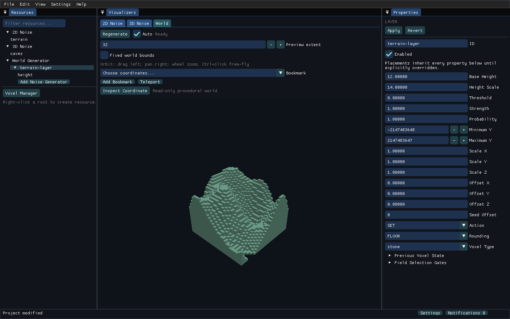

# Procedural Voxel Creator

A native Java 25 procedural-noise and voxel-world editor, with a separately usable headless engine.



This is a **development implementation** of the supplied specification, not a completed A01–A36 release. See [acceptance status](docs/REQUIREMENTS_AND_TESTS.md) for verified behavior and outstanding work.

## Build and run

Install Eclipse Temurin **25.0.4+7** (x64). Gradle 9.2.1 is pinned by the wrapper.

```sh
./gradlew clean test build releaseJars
java --enable-native-access=ALL-UNNAMED -jar build/release/jars/ProceduralVoxelCreator.jar
```

On Windows use `gradlew.bat`. The application needs OpenGL 3.0 or newer. CI also exercises software OpenGL. Startup creates an empty, unsaved project with only the protected 2D Noise, 3D Noise and World Generator roots. Right-click a root to create content.

The Windows workflow packages a runtime and native dependencies as a downloadable Actions artifact after its smoke test succeeds. It does not publish a production release automatically.

## Independent headless engine

`build/release/jars/noise-generator-engine.jar` contains the engine and its non-UI dependencies. It includes no ImGui, OpenGL or LWJGL classes.

```sh
./gradlew :example-client:run
```

See [compiled expressions and batches](docs/COMPILED_EXPRESSIONS.md), [placement world-use controls](docs/WORLD_USE.md), [streaming and display LOD](docs/STREAMING_AND_LOD.md), [authoring and stage analysis](docs/AUTHORING_AND_STAGES.md), [typed field processing](docs/FIELD_PROCESSING.md), [API](docs/API.md), [build instructions](docs/BUILD_AND_RUN.md), [decisions](docs/DECISIONS.md), and the [original assignment](docs/SPECIFICATION.md).

Project-owned source has no open-source license grant. Third-party dependency notices are listed in [LICENSES.md](docs/LICENSES.md).

Exact palette storage, immutable bulk edits and v1/v2 archive compatibility are documented in [EXACT_STORAGE.md](docs/EXACT_STORAGE.md).

Structured validation, grouped logs and actionable notifications are documented in [DIAGNOSTICS_AND_RECOVERY.md](docs/DIAGNOSTICS_AND_RECOVERY.md).

Field-driven thresholds, base height and height scale are documented in [NUMERIC_PARAMETER_DRIVERS.md](docs/NUMERIC_PARAMETER_DRIVERS.md).

Queued priorities, cancellation cleanup and cache ownership are documented in [SCHEDULING_AND_CACHE_ADMISSION.md](docs/SCHEDULING_AND_CACHE_ADMISSION.md).

Bounded opt-in timing/metric captures, percentile inspection and explicit JSON/CSV exports are documented in [PROFILING.md](docs/PROFILING.md), including optional [GPU draw timestamps](docs/GPU_DRAW_TIMING.md).

Optional bounded directional mesh shadows are documented in [DIRECTIONAL_SHADOWS.md](docs/DIRECTIONAL_SHADOWS.md).

Development implementations of [volume self-shadowing](docs/VOLUME_SELF_SHADOWING.md), [field-driven transform components](docs/TRANSFORM_PARAMETER_DRIVERS.md), [property control focus](docs/PROPERTY_CONTROL_FOCUS.md), [coarse volume display detail](docs/VOLUME_DISPLAY_DETAIL.md), [attributed work captures](docs/WORLD_WORK_CONTRIBUTIONS.md), [expression error selection](docs/EXPRESSION_ERROR_SELECTION.md), [curve control navigation](docs/CURVE_CONTROL_NAVIGATION.md), [world-setting focus](docs/WORLD_SETTING_CONTROL_FOCUS.md), [owned Project Settings](docs/PROJECT_SETTINGS_TRANSACTIONS.md), [pinned-control browsing](docs/PINNED_CONTROL_BROWSING.md), [semantic input sharing](docs/SEMANTIC_INPUT_SHARING.md) and [provisional seed inputs](docs/PROVISIONAL_SEED_INPUTS.md) are awaiting validation. GitHub testing is deferred until the program is fully developed; ongoing work is saved on the development branch.

Fragmentation recovery and explicit GPU maintenance are documented in [GPU_ARENA_COMPACTION.md](docs/GPU_ARENA_COMPACTION.md).

Context-aware remapping, transactional binding drafts and atomic preference persistence are documented in [KEYBOARD_INPUT.md](docs/KEYBOARD_INPUT.md).

Future-item defaults and transactional presentation/help settings are documented in [APPLICATION_PROFILES.md](docs/APPLICATION_PROFILES.md).

Theme preview, persistence and contrast feedback: [THEMES_AND_CONTRAST.md](docs/THEMES_AND_CONTRAST.md).

Large resource browsing, filtering and selection: [RESOURCE_BROWSING.md](docs/RESOURCE_BROWSING.md).

Resource pickers, membership editing and export previews: [RESOURCE_SELECTION_WORKFLOWS.md](docs/RESOURCE_SELECTION_WORKFLOWS.md).

Unified Find, precise references and protected navigation: [UNIFIED_FIND.md](docs/UNIFIED_FIND.md).

Mixed resource ordering and World folders: [RESOURCE_HIERARCHY.md](docs/RESOURCE_HIERARCHY.md).

Stable portable import previews and guarded publication: [IMPORT_TRANSACTIONS.md](docs/IMPORT_TRANSACTIONS.md).

Searchable coordinate bookmarks and tab-owned navigation dialogs: [BOOKMARKS_AND_NAVIGATION.md](docs/BOOKMARKS_AND_NAVIGATION.md).

Typed noise authoring, bounded controls and explicit dependency resolution: [NOISE_AUTHORING_WORKFLOWS.md](docs/NOISE_AUTHORING_WORKFLOWS.md).

The sampled-calculus and distance-shape extension adds twelve dimension-aware operations, canonical control metadata and creation defaults. See [field operation semantics](docs/FIELD_CALCULUS_AND_DISTANCE.md). Validation passed after implementation: 502 tests, native workflows, independent mathematical consumers and cross-platform packaging. Full GUI/hardware acceptance remains separate.

The trace-explanation extension adds bounded canonical noise observations, actual comparison/provenance records, one clipped Inspector/Logs view, bounded retained payloads and guarded UUID/control navigation. See [trace contracts](docs/TRACE_EXPLANATIONS_AND_NAVIGATION.md). Validation passed after implementation: 544 tests, native workflows, independent engine-only replay and cross-platform packaging. Full GUI/hardware certification remains separate.

The source-algorithm contract batch centralizes dimensional parameter signatures, named enum authoring, precise validation and creation metadata, with independent upstream C++/Python vectors and JVM raw-bit comparisons. See [source algorithm contracts](docs/SOURCE_ALGORITHM_CONTRACTS.md). Validation passed after implementation: 570 tests, native workflows, independent C++/Python vectors, matching pinned-JVM bit digests and cross-platform packaging. Hardware and full GUI certification remain separate.

The scalar-remapping batch adds weighted noise combinations, explicit falloff domains/metrics/shapes, signed terraces, descending remap clamping and canonical transfer previews. Validation passed after implementation: 599 tests, 548 independent vectors, native Apply/Undo workflows and cross-platform packaging. See [scalar controls](docs/SCALAR_REMAPPING_AND_BLENDING.md) and [evidence](docs/evidence/SCALAR_REMAPPING_VALIDATION.md). Full warp controls and GUI/hardware certification remain separate.

The shared-warp batch adds canonical algorithm/source controls, sampled displacement fields and independent/progressive/sequential octaves to both coordinate and processing stages. Validation passed after implementation: 633 tests, 432 independent vectors across 864 stage cases, native editing and cross-platform packaging. See [warp contracts](docs/WARP_FIELDS_AND_MODES.md) and [evidence](docs/evidence/WARP_CONTROLS_VALIDATION.md). Complete GUI/hardware acceptance remains separate.

Phased placement drivers now control sampling scale/offset and strength/probability with fixed baseline queries, explicit source validation and trace coordinates. Post-implementation validation passed 655 tests, native editing, independent replay and platform packaging. See [driver contracts](docs/NUMERIC_PARAMETER_DRIVERS.md) and [evidence](docs/evidence/PLACEMENT_DRIVER_PHASE_VALIDATION.md). Full GUI/hardware acceptance remains separate.

Browser row and Voxel Manager selection now use an owned Apply/Discard/Cancel guard for modified Properties drafts. Same-owner clicks preserve provisional text; Ctrl/Shift plans and stale decisions preserve sibling and draft ownership. This development implementation and deferred verification definitions are **uncompiled and untested**; see [resource selection guards](docs/RESOURCE_SELECTION_GUARDS.md).

Resource browser mutations now guard unapplied Properties input and publish explicit Apply plus the requested action as one undoable transaction. Failed actions retain the draft; successful edits reconcile selection and cut payload ownership. This implementation and its deferred definitions are **uncompiled and untested**; see [browser transactions](docs/RESOURCE_BROWSER_TRANSACTIONS.md).

New/Open/Exit now protect unapplied Properties input before the committed-document save decision, including raw seed text on a clean project. Canceled/failed transitions retain drafts, and stale file decisions abort before I/O. Standalone Save remains committed-only. This implementation and deferred definitions are **uncompiled and untested**; see [draft transition ownership](docs/PROJECT_DRAFT_TRANSITIONS.md).

Project Undo/Redo now protects unapplied Properties input with an explicit discard-or-cancel decision. History candidates validate before either stack moves; successful steps reconcile selection and retain explicit-save dirty tracking. Implementation and deferred definitions are **uncompiled and untested**; see [history ownership](docs/PROJECT_HISTORY_OWNERSHIP.md).

Import now uses an owned COPY/REUSE/SKIP workspace with explicit stale-preview reload, filtered/clipped rows, bounded diagnostics and displayed-plan Apply gating. It preserves separate Properties drafts. Implementation and deferred definitions are **uncompiled and untested**; see [import workspace](docs/IMPORT_WORKSPACE.md).

The unvalidated development branch adds [manual update results and verified release links](docs/MANUAL_UPDATE_CHECKS.md), alongside [private update trust and safe configuration persistence](docs/UPDATE_TRUST_AND_PREFERENCE_FILES.md). Checks require an explicitly applied endpoint; normal startup performs no update request.

The unvalidated [workspace lifecycle follow-up](docs/WORKSPACE_LIFECYCLE.md) adds durable docking resets, visible side-panel docking actions, saved tool visibility and normal main-window size capture. Physical monitor/DPI and full workspace acceptance remain pending.

The unvalidated [performance preference editor](docs/PERFORMANCE_PREFERENCES.md) stages coupled preview limits and exact 64-bit cell budgets together, with explicit Apply/Revert, failed-save recovery and restart notices. GitHub validation remains paused.

The unvalidated [main-window placement follow-up](docs/MAIN_WINDOW_PLACEMENT.md) saves normal position/maximized intent, fits startup bounds to current monitor work areas, adds Center Main Window and guards startup/recursive native resize frames. Physical monitor/DPI and window-manager acceptance remain pending.

The unvalidated [UI scale follow-up](docs/UI_SCALING.md) extends per-window font multipliers to nineteen top-level targets and adds searchable private scale editing with explicit Apply/Revert and failed-save recovery. Full production-window, popup and physical DPI acceptance remain pending.

The unvalidated [modal layout follow-up](docs/DIALOG_LAYOUT.md) fits sixteen modal presentations to their hosting viewport work areas, wraps action rows and replaces several fixed-width panels. Physical detached-host/monitor and DPI acceptance remain pending.

The unvalidated [selector layout follow-up](docs/SELECTOR_LAYOUT.md) anchors resource/bookmark popups inside their hosting viewport, fits searchable lists to available space and wraps bookmark toolbar actions. Physical monitor/DPI acceptance remains pending.

The unvalidated [Curve Editor layout follow-up](docs/CURVE_LAYOUT.md) keeps Apply/Cancel outside the scrolling inspector, fits floating bounds with docking/monitor-coordinate ownership, and separates plot zoom from body scrolling. Physical monitor/DPI acceptance remains pending.

The unvalidated [status and utility layout batch](docs/STATUS_AND_UTILITY_LAYOUT.md) reserves a measured bottom status strip, keeps notifications reachable in narrow layouts, preserves dock identity and extends floating bounds to thirteen utility/settings windows. GitHub testing remains paused.

The unvalidated [core window layout batch](docs/CORE_WINDOW_LAYOUT.md) extends outer bounds to the five remaining scale targets and adds responsive Inspector XYZ columns with stable raw input, plus bounded browser/trace actions. Full internal-layout and physical DPI acceptance remain pending.

The unvalidated [popup monitor work-area follow-up](docs/POPUP_MONITOR_WORK_AREAS.md) intersects covered modals/selectors with current monitor work areas in absolute-coordinate mode and recovers offscreen detached owners to a usable main client. Relative/no-inventory and physical acceptance limits remain explicit.

The unvalidated [DPI/font-density batch](docs/UI_DPI_AND_FONT_DENSITY.md) combines display density with user/window multipliers before each frame, adds a denser default atlas and preserves nested child/popup font sizes. Physical DPI, GPU font upload and visual quality remain unverified.

The unvalidated [local choice/navigation popup batch](docs/DRAFT_POPUP_LAYOUT.md) bounds local typed-choice selectors, keeps draft-guard actions in a persistent row and preserves the freshness owner of pending source links. Its regression/native/replay definitions remain unexecuted.

The unvalidated [Application Settings layout batch](docs/APPLICATION_SETTINGS_LAYOUT.md) keeps four profile actions outside scrolling content, reflows list/detail panes and stacks numeric controls while preserving private input and field identity. Deferred checks remain unexecuted.

The unvalidated [Appearance layout batch](docs/APPEARANCE_SETTINGS_LAYOUT.md) keeps scale actions persistent, stacks numeric rows, reveals hidden invalid fields and places active preference/theme controls inside the scrolling body. Deferred checks remain unexecuted.

The unvalidated [Input Settings layout batch](docs/INPUT_SETTINGS_LAYOUT.md) reflows clipped shortcut rows, keeps edit/recording actions persistent and preserves same-frame capture suppression during cancellation and retry. Deferred checks remain unexecuted.

The unvalidated [Themes layout batch](docs/THEME_LAYOUT.md) adds persistent recovery actions, responsive palette/contrast panes and RGBA rows, plus sticky rejected-channel save guards. Deferred checks remain unexecuted.

The unvalidated [preference forms layout batch](docs/PREFERENCE_FORMS_LAYOUT.md) gives performance limits, update trust and Workspace separate scrolling bodies and persistent actions, preserving independent private drafts and exact save/retry behavior. Deferred checks remain unexecuted.

The unvalidated [general settings layout batch](docs/GENERAL_SETTINGS_LAYOUT.md) keeps Project Settings transactions and live Editor/Visualization actions reachable, with supported shadow choices and shared Debug/Profiler capture controls. Deferred checks remain unexecuted.

The unvalidated [Profiler workspace batch](docs/PROFILER_LAYOUT.md) adds retained sections, exact next-capture limits, persistent capture/export actions and logical series IDs across filtering/reflow. Deferred checks remain unexecuted.

The unvalidated [diagnostic workspace batch](docs/DIAGNOSTICS_LAYOUT.md) adds responsive result/detail panes and persistent recovery actions, cached immutable event views, displayed-occurrence acknowledgements and publication-owned validation selection. Deferred checks remain unexecuted.

The unvalidated [Find/Trace workspace batch](docs/FIND_AND_TRACE_LAYOUT.md) separates Find filters/results, keeps navigation/copy/paging actions persistent and binds source decisions to exact committed hits or trace observations. Deferred checks remain unexecuted.

The unvalidated [ready editor startup batch](docs/READY_EDITOR_STARTUP.md) keeps native initialization hidden through a rendered editor frame, delays detached presentation, and adds shared failure cleanup and preference guards. Nineteen regression definitions and eight real Desktop scenarios remain unexecuted; physical startup/DPI acceptance remains pending.

The unvalidated [Help/context/About batch](docs/HELP_AND_ABOUT.md) adds active-metadata options and related-topic search, retained topic navigation, explicit Inspector/menu context links and scrollable runtime/license sections with complete copying. Eleven regression definitions and 24 native layout cases remain unexecuted.

The unvalidated [tooltip/fractional-font batch](docs/TOOLTIPS_AND_FRACTIONAL_FONTS.md) preserves fractional inherited text height, adds bounded scaled hover previews and routes outer color/resource drag previews through that scale path. Eleven regression definitions and 30 native cases remain unexecuted.

The unvalidated [expanded expression layout batch](docs/EXPANDED_EXPRESSION_LAYOUT.md) keeps staging/cancellation/error actions persistent, measures editor/feedback viewports and preserves exact error selection through clipping and correction. Eleven regression definitions and six native size scenarios with recovery phases remain unexecuted.

The unvalidated [Inspector layout batch](docs/INSPECTOR_LAYOUT.md) separates Coordinates/Trace, keeps request/restoration/bookmark actions persistent, focuses invalid displayed XYZ and invalidates source decisions after hidden trace replacement. Seven added regression definitions and twelve native layout cases with recovery phases remain unexecuted.

The unvalidated [resource review layout batch](docs/RESOURCE_REVIEW_LAYOUT.md) adds persistent Import/Membership actions, separate review/filter/issue pages, measured clipped rows and Cancel-before-Apply decisions. Nine regression definitions and thirty native page/size cases with transaction recovery remain unexecuted.

The unvalidated [package path/export layout batch](docs/PACKAGE_LAYOUT.md) adds persistent file actions, Choices/Included/Path pages, explicit dependency-preview review and same-frame Cancel priority before I/O. Nine regression definitions, twenty-four native page/size cases and existing engine-only package replay remain unexecuted.

The unvalidated [export hierarchy batch](docs/EXPORT_HIERARCHY.md) adds authored-order folder/layer disclosures, ancestor-aware search, explicit-versus-included choice markers and read-only included hierarchy. Ten regression definitions, twelve native layout cases and operation-only carrier/dependency engine replay remain unexecuted.

The unvalidated [project decision layout batch](docs/PROJECT_DECISION_LAYOUT.md) adds persistent file/history actions, Cancel-before-mutation handling, request-scoped native IDs and retained path/focus recovery. Five regression definitions, thirty-six native form/size cases and independent saved/opened engine replay remain unexecuted.

The unvalidated [resource draft decision layout](docs/RESOURCE_DECISION_LAYOUT.md) keeps selection, browser-action, Source and Find decisions reachable through scrolling explanations and persistent actions. Escape wins simultaneous clicks; post-commit UI refresh callbacks are consumed once. Four regression definitions, eighteen native layout cases and independent replay remain deferred.

The unvalidated [resource form layout follow-up](docs/RESOURCE_FORMS_LAYOUT.md) adds persistent actions to Create, Add Noise Generator, Delete and noise resolution, with searchable replacement and scrolling diagnostics. Browser forms reject stale committed owners; Cancel/Escape takes precedence over submission. Five regression definitions, thirty native cases and independent replay remain deferred.

The unvalidated [private editor decision follow-up](docs/PRIVATE_EDITOR_DECISIONS.md) scopes Expression/Membership/Curve actions to each opening, keeps Curve Apply/Cancel on explicit persistent rows and blocks same-frame Escape publication. Membership also rejects sessions from a reopened project. Three regression definitions, eighteen native reflow cases and independent replay remain deferred.

The unvalidated [Properties layout follow-up](docs/PROPERTIES_LAYOUT.md) keeps Apply/Revert/Show Problems outside scrolling fields, protects footer actions across draft/context changes and disables parent mutation while a private editor is open. Six regression definitions, forty-eight native layout cases and independent replay remain deferred.

The unvalidated [settings decision follow-up](docs/SETTINGS_DECISIONS.md) gives Project Cancel/focused Escape priority and scopes project/profile actions across cancellation, reload and draft resets. Application Escape suppresses mutation while failed saves retain raw input for explicit retry. Four regression definitions, twelve native layout cases and independent replay remain deferred.

The unvalidated [preference decision follow-up](docs/PREFERENCE_DECISIONS.md) scopes Performance, Update trust and UI scale actions to their owned active values and private resets. Escape suppresses footer mutation; failed saves preserve raw retry state, and unrelated preference forms remain independent. Four regression definitions, eighteen native cases and independent replay remain deferred.
