# Verification evidence

- `clean test build dependencyNotices releaseJars`: PASS with 219 JUnit tests on Temurin 25.0.4+7 x64.
- Independent javac/java consumer using only `noise-generator-engine.jar`: PASS.
- Local native smoke: all three engine-backed viewports, explicit save/reload, screenshots with nonblank-frame checks, and exit: PASS on Temurin 25.0.5+8; OpenGL 4.5 Mesa llvmpipe.
- Draft 2020-12 project/user/app schema verification and fixtures: PASS using jsonschema 4.23.0.
- Exact scene hashes at 32³ and 64³: PASS. See [benchmark](BENCHMARK.md).
- Earlier CI run [40045036266](https://github.com/StealthMuskrat/ProceduralVoxelWorldVisualizer/actions/runs/40045036266): Linux and Windows Server 2025 build, independent consumer, native smoke and Windows packaging passed.
- CI run 40047610767 passed Linux/Windows builds, all 35 tests of that revision, native smoke, exact voxel hashes, and the packaged Windows launcher. Its independent JAR SHA-256 values match across both platforms; the manifest comparison needed a platform-independent listing order, fixed in the following workflow revision.

Raw JUnit results are under `junit/`. `linux-native-smoke.log` and `smoke-project.json` accompany the inspected World screenshot below. These tests do not certify the full A01–A36 specification or Windows 11 hardware.

Typed-field extension CI [40050919102](https://github.com/StealthMuskrat/ProceduralVoxelWorldVisualizer/actions/runs/40050919102) passed Linux and Windows builds, native desktop/packaged launcher, exact voxel hashes and identical JAR bytes. The later ray-marched volume extension adds four CPU tests, X/Y/Z slice smoke scenarios, and the analytic native volume probe (linux-volume-probe.log). The following image belongs to volume-smoke-project.json.

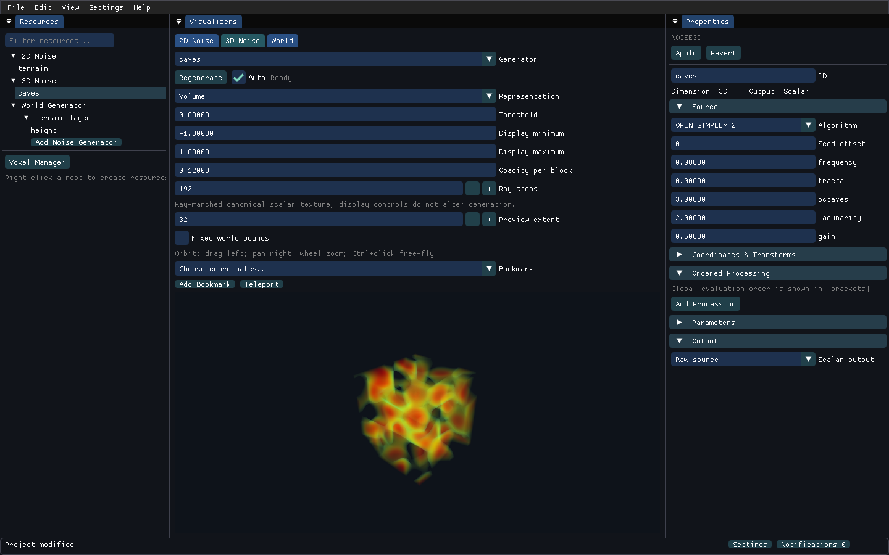

The authoring/stage batch passes 79 JUnit tests, strict schema/curve fixtures, unchanged exact voxel regression hashes, the engine-only consumer including exact stage snapshots, the native numerical volume probe, and native curve/four-stage/three-viewport rendering. linux-authoring-smoke.log and authoring-smoke-project.json accompany these inspected images. The curve dialog uses its isolated demonstration definition and is cancelled during smoke.

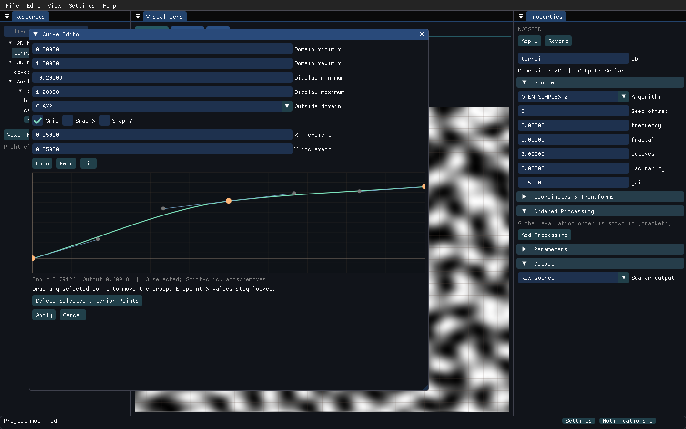

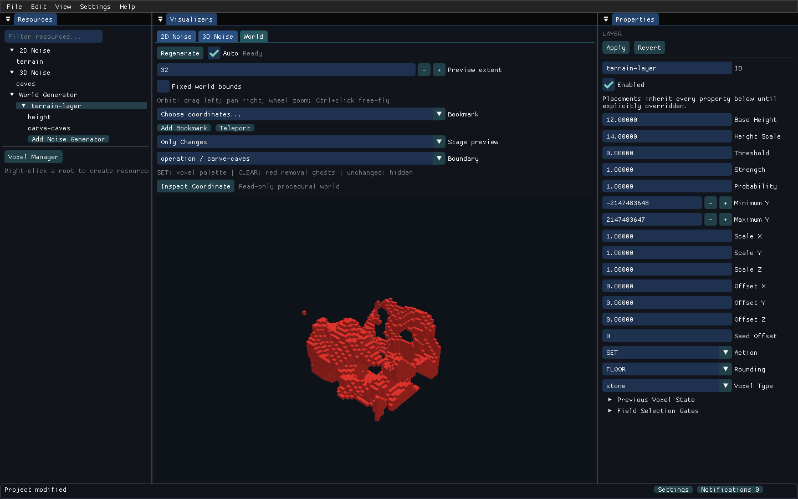

The streaming/runtime batch passes 95 JUnit tests on pinned Temurin 25.0.4+7. `streaming-build.log`, `streaming-artifacts.log` and `streaming-independent-consumer.log` record the final build, exact regression hashes, schemas, engine isolation and external consumer. `linux-streaming-probe.log` records bounded packed uploads, culling, multirow palette updates and indirect/fallback pixel parity. `linux-streaming-smoke.log` includes streamed camera movement, stage/volume/slice modes and save/reload on Mesa llvmpipe OpenGL 4.5. The paired input for the image is `streaming-smoke-project.json`. Pressure controls reduced effective distance during this software-rendered run; this is functional evidence, not representative hardware performance certification.

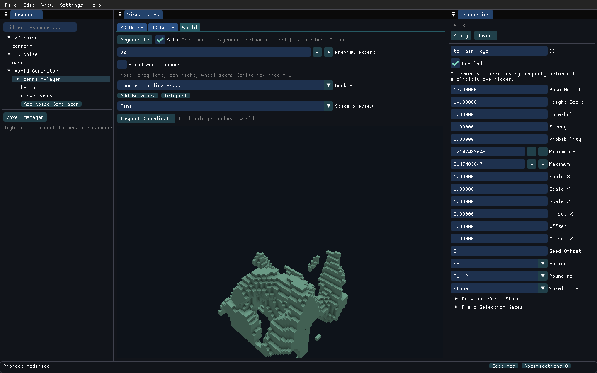

The world-use batch passes 112 JUnit tests on pinned Temurin 25.0.4+7. `world-use-build.log`, `world-use-artifacts.log` and `world-use-independent-consumer.log` record the clean build, schemas, unchanged exact voxel regression hashes, engine isolation and external world-use/owned-collection consumer. `linux-world-use-smoke.log` records the native controls, stage previews, ray-marched volume/slices, streamed camera movement and save/reload. The isolated smoke controls use a copy of the saved `world-use-smoke-project.json` defaults; they exercise the actual property widgets without committing those demonstration edits. Screenshots were inspected and action-row clipping was corrected before the final run. This is scoped native rendering evidence, not a full gesture or Windows 11 hardware certification.

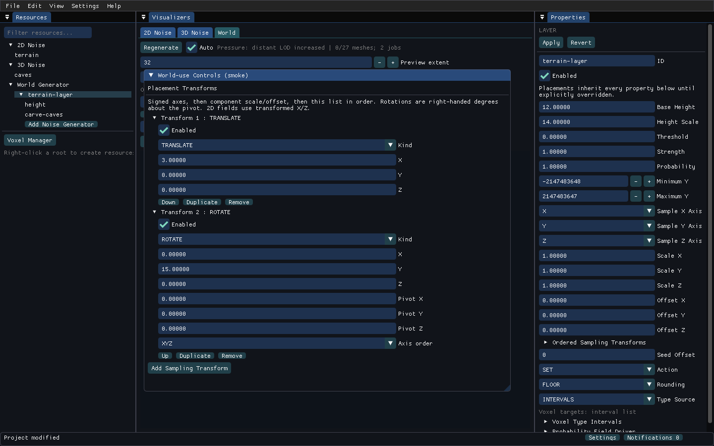

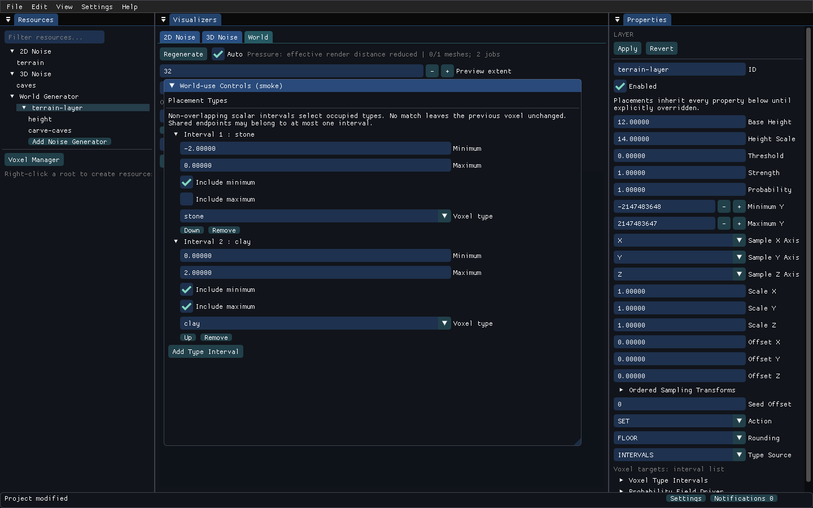

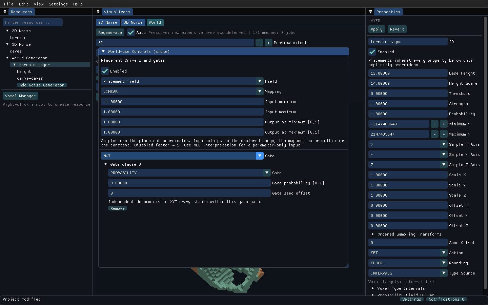

The compiler/batch extension passes 138 JUnit tests on pinned Temurin 25.0.4+7. `compiler-build.log`, `compiler-artifacts.log` and `compiler-independent-consumer.log` record the clean build, schema/fixture checks, unchanged exact voxel hashes, engine isolation and external compiled-expression/strided-grid/point-array consumer. `linux-compiler-smoke.log` adds native expression feedback to the curve, world-use, stage, streaming, volume and slice checks. The inspected screenshot is paired with `compiler-smoke-project.json`. The panel shows constant/branch removal and shared calculations from the actual parser plan. Functional checks do not certify SIMD, hardware throughput or the complete GUI interaction matrix.

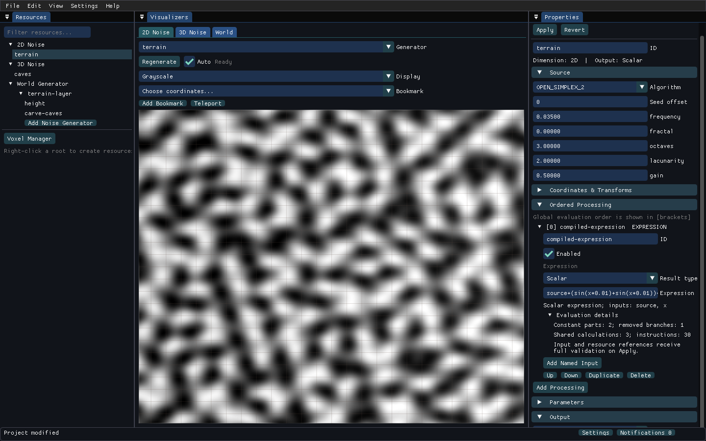

The exact-storage extension passes 156 JUnit tests on pinned Temurin 25.0.4+7. `storage-build.log` and the latest raw JUnit XML record the clean build. `storage-independent-consumer.log` exercises immutable bulk replacement and default v2/explicit v1 archives using only the engine JAR. `storage-artifacts.log` records schema family, unchanged exact voxel hashes and engine isolation. `storage-benchmark.csv` measures current palette storage and v1/v2 raw-tree bytes; `storage-world-benchmark.csv` retains exact generation hashes. See [storage design and scope](../EXACT_STORAGE.md).

For the measured 64³ checkerboard, the current snapshot estimate is 119,456 bytes; raw v1/v2 trees are 1,053,257 / 74,313 bytes respectively. The many-type fixture has 4,097 chunk palette entries and still uses one-bit local leaves. These raw-tree comparisons exclude zlib compression and archive headers. Timing rows are local container observations, not a representative hardware certification or a prior implementation speed comparison.

The diagnostics/recovery extension passes 176 JUnit tests on pinned Temurin 25.0.4+7. `diagnostics-build.log` and the latest raw JUnit XML record the clean build. `diagnostics-artifacts.log` records the external engine-only consumer, unchanged exact voxel hashes, schema family and engine isolation. `linux-diagnostics-smoke.log` records three new native panels, a rejected expression draft, grouped events, source navigation and unchanged document state, plus the existing viewport/stage/volume/slice/streaming and numerical rendering checks. The screenshots below are paired with `diagnostics-smoke-project.json`; the invalid expression is an intentionally rejected unsaved draft and is absent from that valid project file.

Final native checks ran separately from the CPU regression benchmark. One overlapping local run reached the existing critical-pressure pause and failed the complete-preview smoke assertion; the standalone final run passed with the same pressure and explicit-resume policy. This evidence does not certify responsiveness under arbitrary CPU contention, every recovery gesture or Windows 11 hardware.

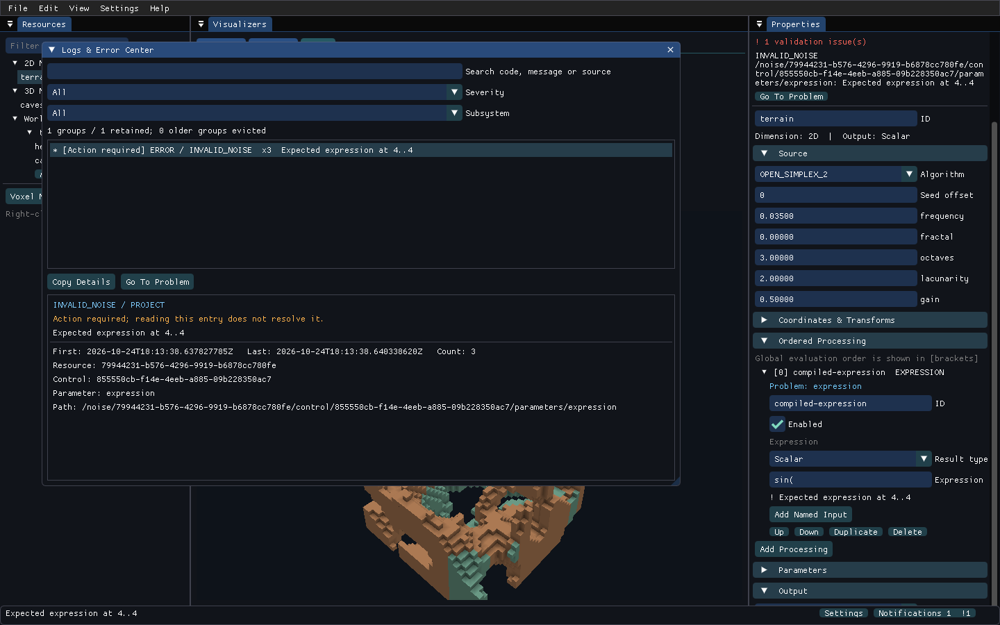

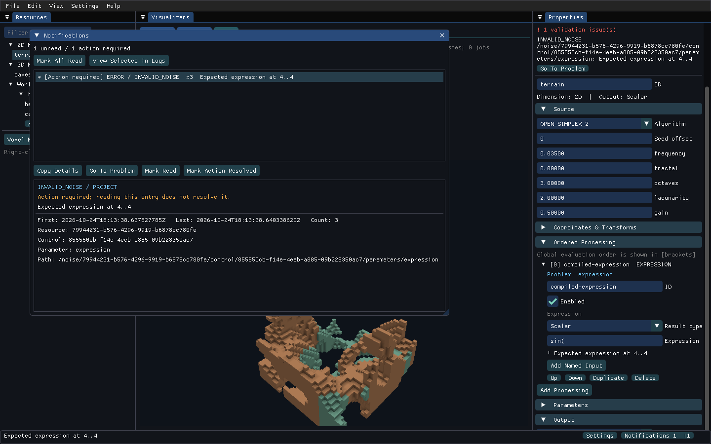

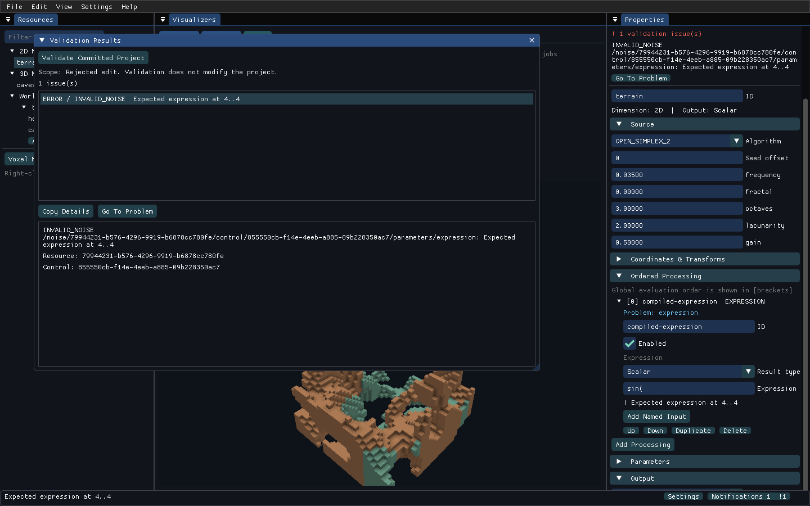

The numeric-parameter extension passes 195 JUnit tests on pinned Temurin 25.0.4+7. `parameters-build.log` and raw JUnit XML record the clean build. `parameters-artifacts.log` records the engine-only numeric mapping/trace/JSON consumer, unchanged exact voxel hashes, schema family and engine isolation. `linux-parameters-smoke.log` adds the actual ordered numeric controls to the existing diagnostics, curve, world-use, stage, streaming, volume and slice scenarios and both renderer probes. The inspected screenshot is paired with `parameters-smoke-project.json`; its isolated control window edits a settings copy. Normal startup creates no demonstration resources. Broader GUI gestures, arbitrary destinations and representative hardware performance remain outside these checks.

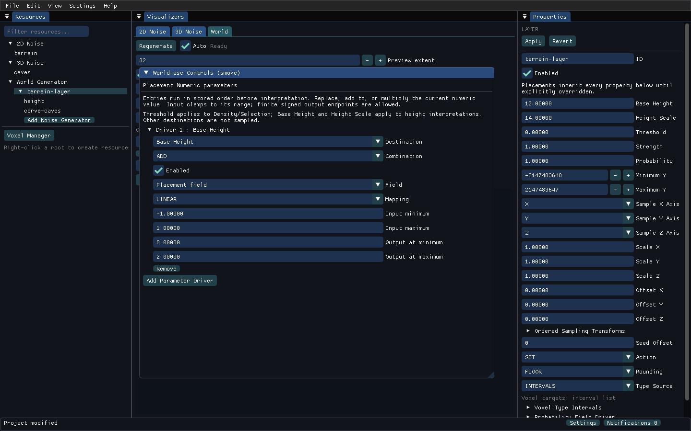

The scheduling/cache extension passes 219 JUnit tests on pinned Temurin 25.0.4+7. `scheduler-build.log` and the latest raw JUnit XML record the final clean build. `scheduler-artifacts.log` records the independent engine-only priorities/region/stats consumer, unchanged exact voxel hashes, schemas and engine isolation. `linux-scheduler-smoke.log` adds the real Profiler queue snapshot to the complete existing native smoke and numerical probes. The native/artifact checks used JARs byte-identical to the final build; the last rebuild added only a running-abandonment regression test and strengthened a snapshot assertion. The inspected screenshot is paired with `scheduler-smoke-project.json`. Queue counters are zero in that early preview frame because the initial numerical previews use their separate bounded background executor; no synthetic workload is presented as real metrics. These functional checks do not certify representative hardware performance or every scheduler/consumer race.

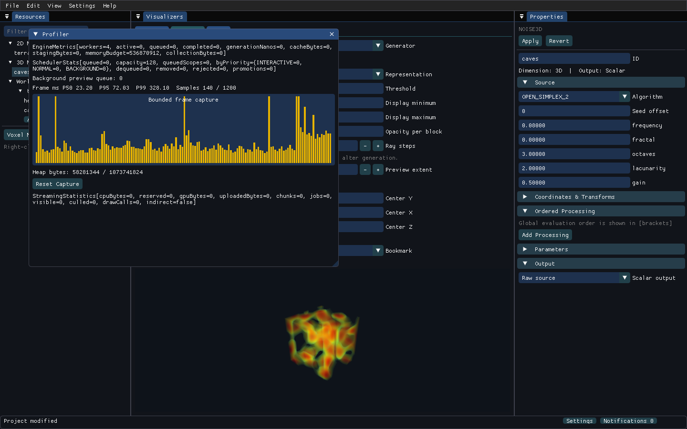

The bounded-profiler extension passes 240 JUnit tests on pinned Temurin 25.0.4+7. `profiler-build.log` and the latest raw JUnit XML record the full build. `profiler-artifacts.log` records the independent engine-only capture/export consumer, unchanged exact voxel hashes, schemas, engine isolation and independent recomputation of exported bounds/means/nearest-rank percentiles. The engine capture contains 36 real samples across four series; its JSON/CSV pair is retained here. `profiler-jar-hashes.txt` identifies the tested JARs. Storage/world timing rows remain local container observations.

`linux-profiler-smoke.log` records all native scenarios and both numerical probes, plus the real opt-in capture panel and exported frame/heap/GC/queue/memory measurements: 64 retained samples across 12 series. The screenshot below is paired with `profiler-smoke-project.json` and `profiler-native-capture.json` / `.csv`. It was taken during recording; the exported pair is the later stopped snapshot. Engine queue/generation counters are zero in this early frame because numerical previews use the separate background executor. GPU completion times are not measured.

`linux-profiler-initial-smoke.log` retains an initial fixed-frame smoke failure: Only Changes had not completed before its next stage. The harness now waits at each stage boundary, with a 30-second timeout, before switching modes; production preview/pressure behavior is unchanged. The final run passed all assertions without relaxing pressure limits. This does not certify every GUI gesture, exclusive layer cost or Windows 11 hardware performance.

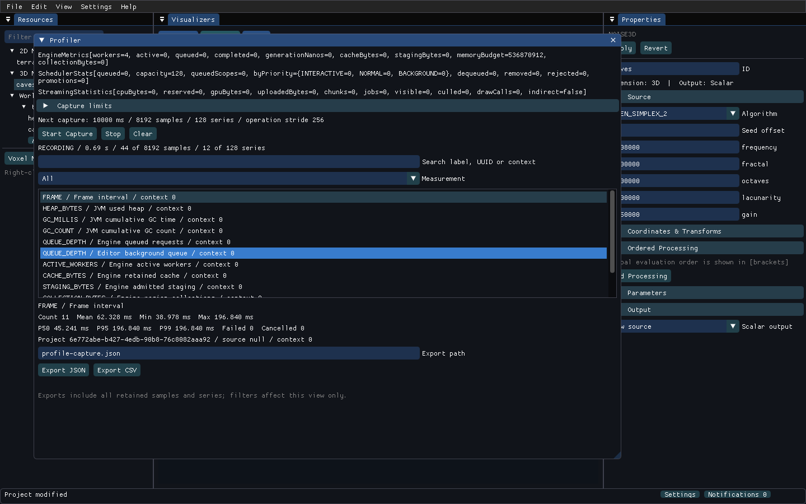

The GPU-arena extension passes 249 JUnit tests on pinned Temurin 25.0.4+7; raw XML includes the independent randomized intermediate-layout oracle. `compaction-build.log` records the final full build and `compaction-artifacts.log` records engine-only consumer/export validation, schema family, unchanged exact voxel hashes and the byte-identical headless JAR. `compaction-jar-hashes.txt` identifies the tested artifacts; benchmark rows are local observations rather than certified speedups.

`linux-compaction-smoke.log` records the existing desktop scenarios and volume probe, plus framebuffer equality through overlapping triangle and visible-point moves, both submission paths, deferred retirement/admission retry, explicit requests and partial-epoch replacement. The probe reports actual OpenGL 4.5 and strict 3.0 contexts, with indirect capability true/false respectively. The first probe run deliberately failed its nonempty-point-fixture assertion; `linux-compaction-initial-smoke.log` retains that evidence. The fixture was moved to explicit central coordinates and the final complete run passed, including the same triangle relocation checks.

The inspected screenshot is paired with `compaction-smoke-project.json`. It shows the real late-run streamed scene's empty vertex allocations and retained 32 MiB VBO capacity, plus the stopped earlier frame capture. No synthetic fragmentation or moved-byte values are injected into the normal editor view. The native probe separately forces a fragmented arena and asserts every resulting image. The visible invalid `sin(` text is the intentionally rejected diagnostic draft from the existing smoke scenario; it is absent from the valid saved project. GPU completion timings, device-loss recovery, physical bus accounting and representative hardware throughput are not certified.

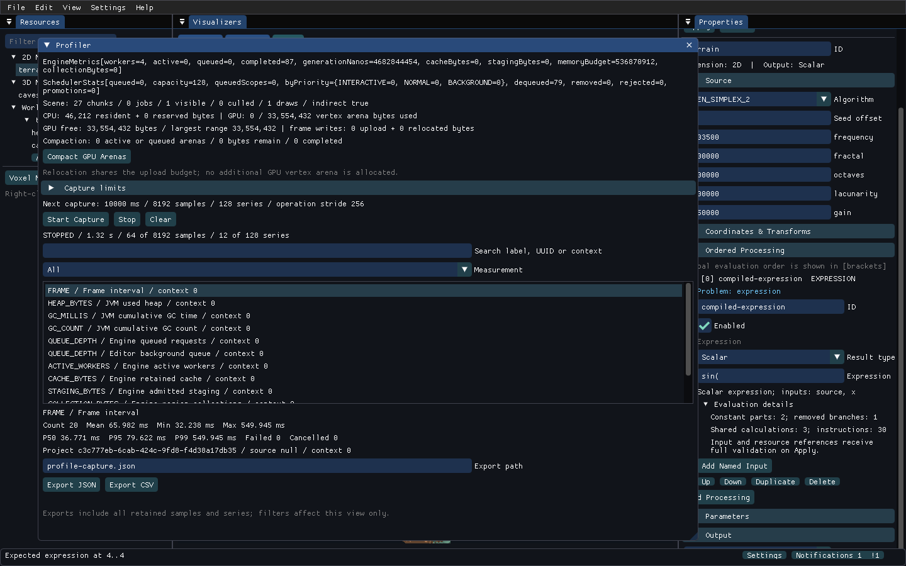

The keyboard-input extension passes 274 JUnit tests on pinned Temurin 25.0.4+7. `input-build.log` and current raw XML record the final full build. `input-artifacts.log` records independent engine-only consumption, unchanged voxel hashes, schema/fixture checks and semantic agreement between the generated input schema/defaults/help/registry and the checked-in contracts. The engine JAR remains byte-identical to the prior baseline; `input-jar-hashes.txt` identifies the final tested artifacts. Benchmark timings remain local observations.

`linux-input-smoke.log` records the native input panel/conflict assertion, all prior desktop scenarios, both OpenGL capability paths and the isolated real-key-event probe. `input-native-user-config.json` is the probe's explicitly created preference snapshot, validated against the schema and independently checked for canonical chords and context conflicts. It contains a real captured Shift+Alt+Super+F9 remap, reloads without changing project state, and is not a user configuration collected from another session.

`linux-input-initial-smoke.log` retains the initial native layout assertion: manually extending a clipped row's cursor without a submitted item violated ImGui's extent rules. The panel now lets the list clipper measure its stable rows; the complete final run passed. The inspected screenshot below is paired with `input-smoke-project.json`. Its Ctrl+S conflict is an intentionally staged private draft; Apply is disabled and active Find stays Ctrl+F. The pre-existing Project modified status comes from smoke resource creation, not shortcut editing. This evidence does not certify every OS-reserved chord, keyboard layout/IME, focus gesture, DPI case or Windows 11 hardware scenario.

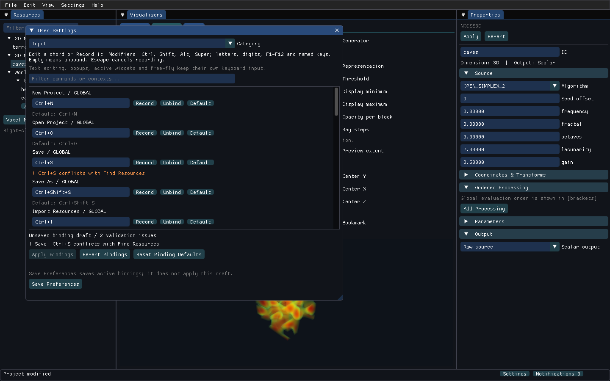

The Application Settings extension passes 293 JUnit tests on pinned Temurin 25.0.4+7; current raw XML contains 48 suites. `metadata-build.log` records the final clean build. `metadata-artifacts.log` records the external engine-only consumer, unchanged exact voxel hashes, schemas, engine isolation and independent validation of persisted profile/default choices. `metadata-reference.log` records atomic profile apply/restart, concrete creation values, ownership and preservation of existing document/draft/revision/history/evaluation. The explicitly generated reference inputs are `metadata-reference-app-config.json` and `metadata-created-project.json`. `metadata-jar-hashes.txt` identifies the tested JARs; the engine JAR is byte-identical to the previous batch. Benchmark timings remain local observations.

`linux-metadata-smoke.log` records the private Application Settings draft assertion, all previous desktop scenarios, volume numerical checks, both OpenGL capability paths and real-key-event preferences checks. The native capture retains 86 samples across 12 series and passes independent JSON/CSV recomputation. The inspected screenshot is paired with `metadata-smoke-project.json`; the staged 0.625 creation override is never applied implicitly. The visible Project modified status comes from smoke resource creation. These checks do not certify every settings gesture, every dynamic mathematical input domain, the complete A01–A36 matrix or Windows 11 hardware.

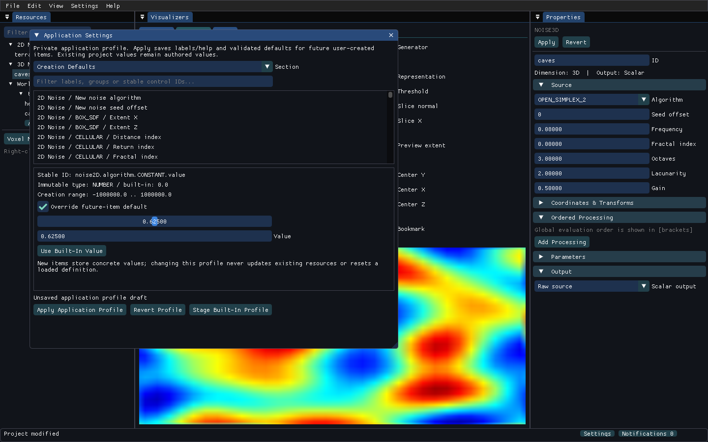

The theme extension passes 309 JUnit tests on pinned Temurin 25.0.4+7; current raw XML contains 50 suites. `theme-build.log` records the final clean build; `theme-artifacts.log` records independent engine consumption, unchanged exact voxel hashes, schemas, profile validation and engine isolation. `theme-jar-hashes.txt` identifies the tested artifacts; the engine JAR is byte-identical to the prior baseline. Timing CSVs remain local observations.

`theme-reference.log` records the isolated real ImGui probe: native palette resolution/restoration, a readable inspector during private low-contrast preview, workspace-save exclusion, atomic save/restart and unchanged project/evaluation. `theme-native-contrast.json` retains the raw native colors and all 78 ratios for Dark, Light and alpha profiles; independent Python recomputes them from those colors. `theme-reference-user-config.json` and `theme-preview-workspace-save.json` are explicitly created reference outputs, not collected user preferences.

`linux-theme-smoke.log` adds the private theme assertion to all existing desktop and numerical/render/input scenarios, including actual OpenGL 4.5 and strict 3.0 contexts. The native profile JSON/CSV pair contains 64 samples across 12 series and passes independent validation. The screenshot below is paired with `theme-smoke-project.json`. Identical Text/WindowBg colors intentionally dim the surrounding workspace; the inspector keeps its own readable controls and reports the 1:1 pair. Closing restores the active theme without publishing the draft. Broader GUI/DPI/platform acceptance, arbitrary compositing/display conditions, WCAG conformance and Windows 11 hardware are not certified.

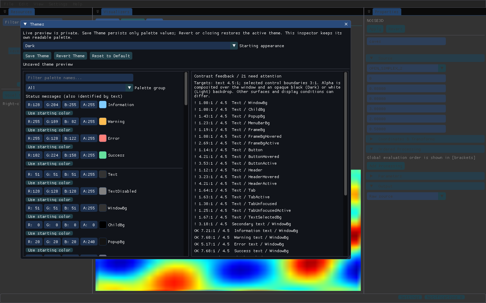

The resource-browser extension passes 321 JUnit tests on pinned Temurin 25.0.4+7; current raw XML contains 51 suites. `browser-build.log` records the final clean build. `browser-artifacts.log` records independent engine consumption, unchanged voxel hashes, schemas, engine isolation and profile/theme/input/browser validation. `browser-jar-hashes.txt` identifies the tested artifacts; the engine JAR is byte-identical to the previous baseline. Benchmark timings remain local observations.

`browser-reference.log` and `resource-browser-reference.json` retain the isolated real ImGui fixture with 7,102 explicitly created resources. The top/scrolled views submitted 19/20 tree rows and 12 manager rows, with one index build and three unchanged projections. Filtering produced three ancestor/target tree rows and one manager row, with six projections and still one build. Independent Python checks those counts, filter membership, depth and the analytical 199.9 constant. Document content, draft identity, history, revision, dirty state and numerical samples remain unchanged through these read-only operations. These counts describe the measured viewports, not a general latency or hardware performance certification.

`linux-browser-smoke.log` adds the real Voxel Manager to all previous desktop scenarios and rendering/key-event probes. The inspected screenshot below is paired with `browser-smoke-project.json`. The paired native profile export contains 64 samples across 12 series and passes independent validation. Full drag/drop/rename/keyboard gestures, all scaling/scroll cases, broader lists, cross-kind ordering/world folders and complete Windows 11 GUI acceptance remain outside this evidence.

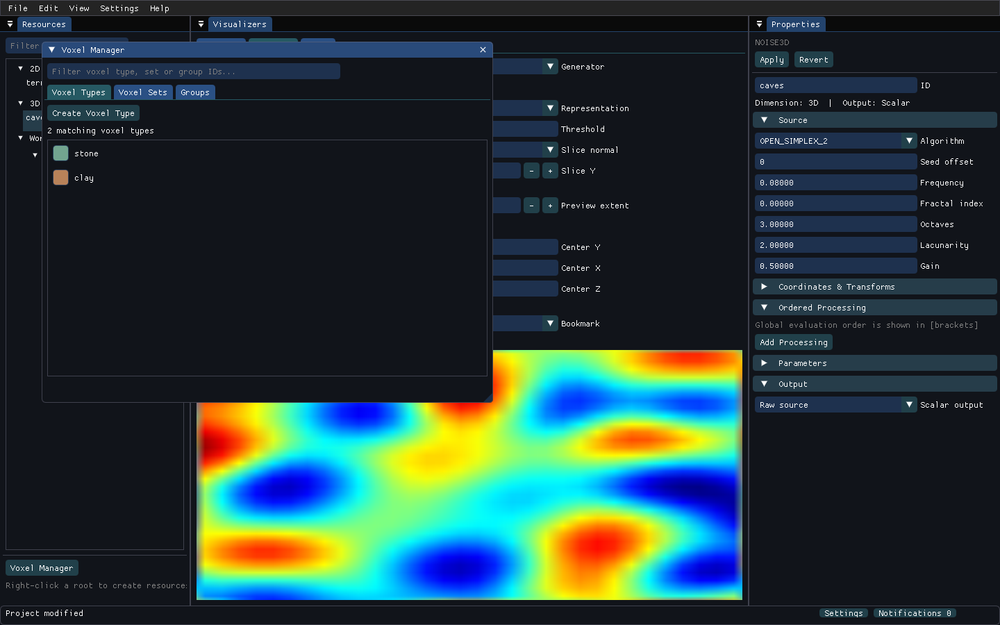

The resource-selection workflow extension passes 339 JUnit tests on pinned Temurin 25.0.4+7; current raw XML contains 54 suites. `selection-build.log` records the final clean build. `selection-artifacts.log` records independent engine consumption, exact voxel hashes, schema family, engine isolation and the previous browser/profile/theme/input regressions. `selection-jar-hashes.txt` identifies the tested artifacts; the engine JAR is byte-identical to the previous baseline. Timing CSVs remain local observations.

`selection-reference.log`, `resource-workflows-reference.json` and `resource-workflows-selection.json` retain the explicit isolated native reference. Actual text input filters the open picker/membership catalogs, mouse input selects exactly once, Escape cancels membership, and service Apply preserves a separately pending ID with one Undo/Redo. The 2,000-type catalog submitted 11 unfiltered picker rows, 8 membership rows and 4 export rows; filtered lists submitted one each. Export prepared its canonical payload once across repeated rendering/filtering. Independent Python and the engine-only ResourceSelectionConsumer check exact type/member identities, selected closure, empty world and the constant 0.625 field. These fixture counts are scoped widget evidence, not representative hardware latency certification.

`selection-initial-reference.log` retains an initial strengthened-harness failure: replacing an already active ImGui text buffer programmatically did not exercise the user input path. The final probe types through native input events and passes the full unfiltered/filtered assertions. This was a harness correction, not an application search fallback.

`linux-selection-smoke.log` records the real Export dialog and all prior desktop/native numerical checks, including both reported OpenGL capability paths. The inspected screenshot below is paired with `selection-smoke-project.json`; it previews one explicitly selected noise resource, writes no resource package and closes through the smoke harness. The native profiler export contains 86 samples across 12 series and passes independent recomputation. The 2,000-type reference package above is a separately generated probe output. Full GUI/import/keyboard/scroll/DPI acceptance, other lists, arbitrary filesystem failures and Windows 11 hardware remain separate.

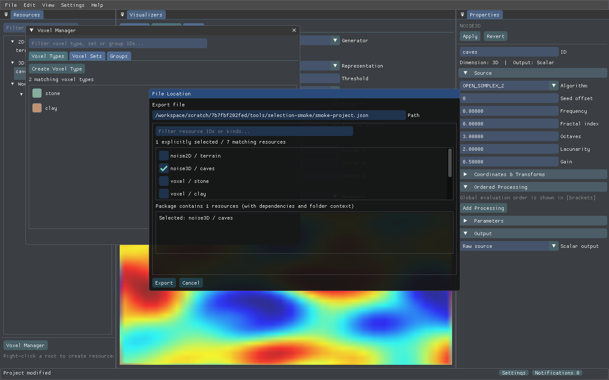

The unified-Find extension passes 360 JUnit tests on pinned Temurin 25.0.4+7; current raw XML contains 57 suites. `find-build.log` records the final clean build; `find-artifacts.log` records independent engine consumption, exact voxel hashes, schemas, engine isolation and previous selection/browser/profile/theme/input regressions. `find-jar-hashes.txt` identifies the tested artifacts; the engine JAR is byte-identical to the previous baseline. Timing CSVs remain local observations.

`find-reference.log` and `unified-find-reference.json` retain the explicit isolated native fixture with 1,000 noise resources. It submits 11/12 top/scrolled rows while retaining one index and one query, then filters to one exact folder-scoped noise result. Real mouse activation opens the draft decision; Escape preserves the rejected draft. Explicit discard, precise input-binding location, exact private curve-point selection and the independent 0.25 + 0.5 result pass without changing project/history/dirty state. Independent Python checks the report. Stale source-commit rejection additionally has a dedicated unit contract.

`linux-find-smoke.log` records the real Find window and all prior desktop/native numerical checks, including reported OpenGL 4.5 and strict 3.0 contexts. The inspected screenshot below is paired with `find-smoke-project.json`; it shows committed 3D breadcrumb results and performs no result activation. The paired native profiler capture contains 64 samples across 12 series and passes independent recomputation. These scoped checks do not certify every conditional control, truncated deep/large text search, global draft behavior outside Find, all GUI/DPI/platform gestures or Windows 11 hardware.

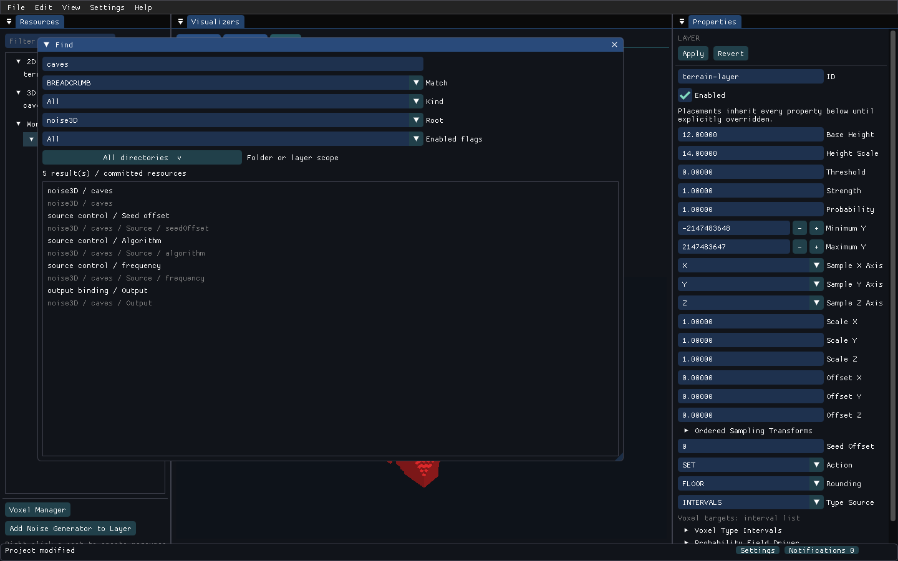

The resource-hierarchy extension passes 389 JUnit tests on pinned Temurin 25.0.4+7; current raw XML contains 59 suites. `hierarchy-build.log` records the final clean build. `hierarchy-artifacts.log` records independent engine consumption, exact unchanged voxel hashes, schemas/registry checks, engine isolation and the prior Find/selection/browser/profile/theme/input references. `hierarchy-jar-hashes.txt` identifies the tested artifacts. Both JARs change in this batch because authoring model/API fields and hierarchy services are included in the headless artifact; no byte-identity claim is made. Timing CSVs remain local observations.

`hierarchy-reference.log`, `hierarchy-reference.json` and `hierarchy-organized-project.json` retain the explicit native fixture. Its displayed World order is second-folder/CLEAR before first-folder/SET while execution remains SET then CLEAR, producing EMPTY. Root order shows a noise before its folder; visible layer ordinals remain 1/2. Eight resource rows render in the fixture. One Undo/Redo, unchanged computation identity, owned export and constant noise expectations pass. Python independently validates the registry/schema/parent/order/override structure. The engine-only HierarchyConsumer checks EMPTY across roots 2/4/8 and negative chunks, then explicitly changes execution to CLEAR then SET and checks solid voxels.

`hierarchy-initial-build.log` and `hierarchy-schema-build.log` retain the two initial compile failures (a remapping-helper name and a schema local-variable collision); both were corrected before the final full validation. No native assertions were relaxed.

`linux-hierarchy-smoke.log` records actual organizational edits in the existing desktop scenario, saved as `hierarchy-smoke-project.json`. The inspected screenshot below is paired with that model, rather than the earlier initial smoke save. It shows an expanded World folder, unchanged layer execution ordinal and the mixed noise/folder order. The native profiler export contains 86 samples across 12 series and passes independent recomputation. Complete drag/drop/clipboard/rename/DPI/platform acceptance, arbitrary failure timing, representative performance and Windows 11 hardware remain outside this evidence.

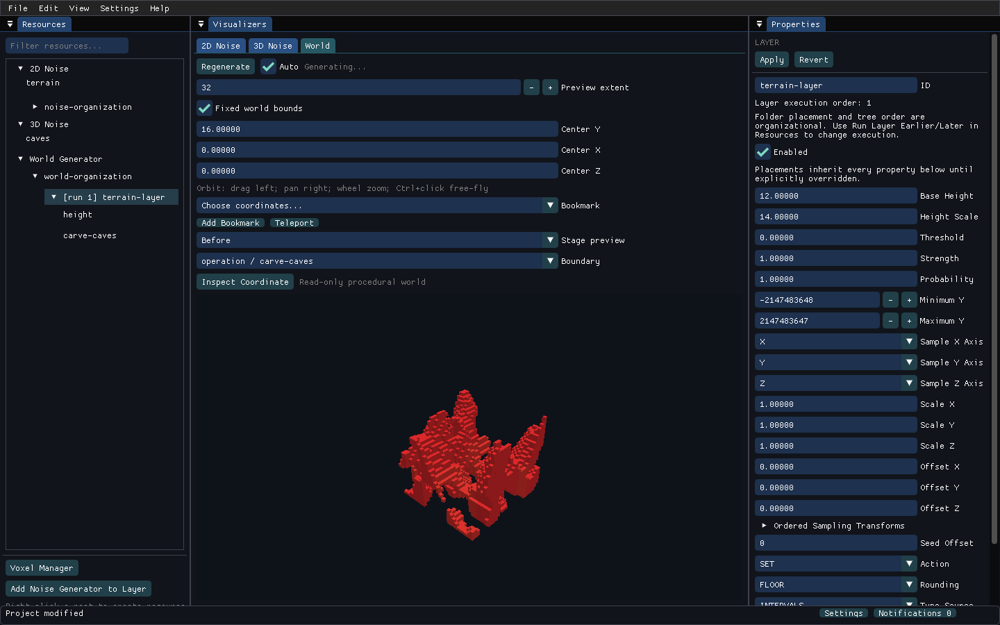

The bookmark/navigation batch passed 428 tests and both platform/native/package/reproducibility jobs. See [BOOKMARK_VALIDATION.md](BOOKMARK_VALIDATION.md) and [bookmarks-reference.json](bookmarks-reference.json).

The larger typed-authoring batch passed 464 tests and both platform/native/package/reproducibility jobs. See [NOISE_AUTHORING_VALIDATION.md](NOISE_AUTHORING_VALIDATION.md) and [noise-authoring-reference.json](noise-authoring-reference.json).

The sampled-calculus/distance-shape batch passes 502 tests and platform CI, including 22 native production item details, actual filter-strength editing, private Apply/Undo/Redo and independent mathematical/saved-fixture consumers. See [field operation evidence](FIELD_OPERATIONS_VALIDATION.md) for scope, toolchain, raw reports and remaining acceptance limits.

The trace-explanation batch passes 544 tests and platform CI, including canonical typed observations, actual comparisons/setting origins, bounded shared Inspector/Logs presentation, stale-source and draft guards, Unicode-safe text pages, portable engine-only replay and binary reproducibility. See [trace evidence](TRACE_EXPLANATIONS_VALIDATION.md) for raw reports, toolchains and remaining acceptance scope.

The source-algorithm batch passes 570 tests and platform CI, with canonical source/creation signatures, named native controls, 3,264 independent upstream C++ comparisons, exact Python analytic/hash/seed vectors and 20 matching pinned-JVM raw-bit digests. See [source algorithm evidence](SOURCE_ALGORITHM_VALIDATION.md) for numerical tolerance, exact-match counts, raw reports, compatibility and remaining matrix/hardware scope.

The scalar-remapping batch passes 599 tests, 548 independent manipulation vectors and platform CI, with shared controls, explicit falloff domains/shapes, weighted combinations, real numeric/searchable native editing and private Apply/Undo. See [scalar remapping evidence](SCALAR_REMAPPING_VALIDATION.md) for raw reports, exact chain arithmetic, compatibility and remaining scope.

The shared-warp batch passes 633 tests and platform CI with canonical algorithm controls, sampled per-axis displacements, explicit octave/axis domains, 432 independent vectors across 864 compiler-stage cases and real native source/mode/numeric editing with Apply/Undo. See [warp evidence](WARP_CONTROLS_VALIDATION.md) for raw reports, exact 55/198 arithmetic, compatibility and remaining scope.

The phased placement-driver batch passes 655 tests and both-platform CI with explicit baseline sampling controls, post-selection strength/probability rows, actual trace coordinates, native private editing and 147-cell independent replay. See [phase evidence](PLACEMENT_DRIVER_PHASE_VALIDATION.md) for raw reports, compatibility and remaining scope.

The project-file transition batch passes 807 tests across 104 suites and both-platform native/package/reproducibility checks. Twenty production modal/file-I/O scenarios cover dirty New/Open/Exit choices, path cancellation/Escape, failed-save abort/retry and failed-open session retention. See [project-file evidence](PROJECT_FILE_TRANSITIONS_VALIDATION.md) for raw reports and remaining physical GUI/hardware scope.

The input-binding navigation batch passes 816 tests across 105 suites and both-platform native/package/reproducibility checks. Full production Properties acknowledges 13 binding focus destinations, repairs a rejected input by keyboard, retains independent per-item selections and validates Apply/Undo/Redo against saved-field arithmetic. See [input-binding evidence](INPUT_BINDING_NAVIGATION_VALIDATION.md) for raw reports and remaining specialized/physical GUI scope.

The bounded isosurface batch passes 827 tests across 106 suites and both-platform native/package/reproducibility checks. Ten new mesher contracts and an admission contract cover area, winding, complements, extremes/subnormals, shared faces, closed-sphere topology, cancellation and byte limits. Native GL compares 75 analytical lighting pixels on compiled fields; independent raw-mesh replay passes. See [isosurface evidence](ISOSURFACE_EXTRACTION_VALIDATION.md) for scope and remaining streaming/GUI/hardware work.

The volume-encoding batch passes 841 tests across 108 suites and both-platform native/package/reproducibility checks. Fourteen new encoding/transfer cases and 23 native optics cases cover extremes/subnormals, neighboring endpoints/thresholds, gradients, ray slabs and control-only reuse. Independent Decimal/texel/ray/Beer-Lambert replay passes. See [volume evidence](VOLUME_ENCODING_VALIDATION.md) for raw reports, the corrected parallel-boundary failure and remaining streaming/GUI/hardware scope.

The streamed-isosurface batch passes 854 tests across 111 suites and both-platform native/package/reproducibility checks. Thirteen new contracts cover cached shared corners, quantization, cancellation/admission, queue recovery and signed scene travel. Native mixed-precision GPU uploads/compaction and production streaming/fixed transitions pass independent packed geometry, pixel, epoch and view-only replay. See [streamed surface evidence](STREAMED_ISOSURFACES_VALIDATION.md) for reports and remaining volume/LOD/GUI/hardware scope.

The bounded volume-upload batch passes 861 tests across 112 suites and both-platform native/package/reproducibility checks. Seven memory-backend contracts plus staging-inclusive admission verify complete-only texture replacement. Native probes check 4,913 exact texels, 259 byte-bounded advances, optical pixels, unpack/PBO restoration, retired scene framebuffers and production cancellation/GPU-rejection/retry metadata. See [volume-upload evidence](VOLUME_UPLOAD_VALIDATION.md) for raw reports and remaining streaming/GUI/hardware scope.

The streamed-volume batch passes 870 tests across 113 suites and both-platform native/package/reproducibility checks. Nine contracts cover canonical tile reuse, signed bounds, encoding, cancellation/ownership and lock-safe callbacks. Native checks verify 262,144 seam-spanning GPU texels, analytical optics, signed XYZ travel under one compiled source, retained manual definitions, canceled uploads, GPU/queue recovery and fixed return. See [streamed-volume evidence](STREAMED_VOLUME_VALIDATION.md) for raw reports and moving-window/performance/GUI/hardware limits.

The resident-volume reuse batch passes 878 tests across 114 suites and both-platform native/package/reproducibility checks. Eight contracts and twelve native scenarios in normal/actual strict OpenGL 3.0 contexts cover exact signed texels, overlap/host partitions, extent/source/encoding changes, partial publication and hostile GL state. Independent binary replay and native full-upload framebuffer parity pass. See [GPU overlap evidence](VOLUME_GPU_REUSE_VALIDATION.md) for raw reports, corrected fixture/oracle expectations and remaining residency/LOD/GUI/hardware scope.

The streamed scalar-pressure extension passes 886 tests across 115 suites. Effective visibility/cache reduction, deferred windows, critical pause and actual Resume preserve canonical sampling, accepted source/display ownership and configured preferences. Queued window peaks enter profiler memory immediately. Twelve native observations and independent binary/opacity/version replay cover upload/queue cancellation, manual-source retention, CPU/GPU recovery and deferred-budget critical escalation. See [scoped pressure evidence](VOLUME_PRESSURE_VALIDATION.md). Sparse residency, coarser scalar LOD, representative stress/performance and full GUI/Windows 11 hardware acceptance remain separate.
